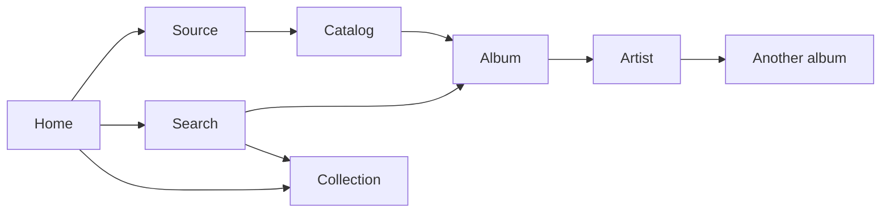

# Kalinka browsing and navigation design guide

Kalinka uses one browsing model across phones, tablets and desktops. Opening an item shows its page, explicit playback actions control the queue, and Back restores the previous visit. Larger screens use a bounded player panel and adapt the browsing content through artwork grids, metadata columns and multiple compact items per row.

This is the implementation specification for the agreed redesign. The interaction rules and page responsibilities below are the target behavior. Dimensions marked as starting values need validation in rendered Flutter layouts before becoming shared tokens. The [implementation status](#implementation-status) section records what has landed.

Use [PALETTE.md](../PALETTE.md) for colours, typography and Home controls, [the settings guide](settings-design-guide.md) for Configuration and Customise Home, and [the Home catalog contract](home-catalogs.md) for capabilities, pins and persistence. This guide supersedes the earlier prototype's navigation and fixed split-layout assumptions. Existing pin formats, source capabilities and settings behavior remain applicable.

## Design decisions

1. Give browsing the growing share of a large window; keep the player at a useful bounded width. Preserve the expanded-player experience for focused listening.
2. Open sources, catalogs, folders, albums, artists, playlists and collections through consistent page navigation. Remove inline expansion of albums and playlists from listings.
3. Use layouts appropriate to the content. Album catalogs benefit from artwork grids; wide lists need useful metadata columns or several compact items across a row.
4. Keep name matching and smart recommendations together in Search. Preserve the existing filter panel, applied chips, saved combinations and section-specific source shortcut.
5. Keep Home's order: search, collections, music sources, pinned catalogs. Home contains previews; catalog pages contain complete listings.
6. Preserve provider identity, declared capabilities, backend order and complete playback contexts. Add shared backend metadata when necessary; never introduce plugin-name rules in the UI.

## Visual references

The wide concepts illustrate the bounded player, Home shelves, aligned search metadata and source recommendation groups. Their music, counts and artwork are illustrative. The written behavior and repository tokens govern implementation; do not reproduce accidental details, duplicated status indicators or unsupported metadata from generated images.


The [interactive navigation prototype](mocks/browse-navigation/index.html) demonstrates routes, filtering and playback contexts. Its older equal-width panels and some simplified controls are not the final responsive design. The album catalog grid, compact list grid and wide entity pages still need rendered review during implementation.

## Interaction rules

| Element | Primary activation | Separate actions |
| --- | --- | --- |
| Source, catalog or folder | Open its listing page when browsable | Declared filtering and catalog pinning where applicable |
| Album, artist, provider playlist or user collection | Artwork, title, row and right chevron open the same detail page | Play, Play next, Enqueue and editing where supported |
| Track | Start playback with the context defined below | Overflow exposes queue actions and supported album or artist links |
| Home preview | Open its item directly, or its saved catalog through the catalog action | Preserve the selected preview format and saved filters |
| View all | Open the complete listing as a normal navigation destination | Preserve source, query, filters, order and result snapshot |
| Grid or List control | Change presentation on the current page | Preserve filtering, order and the visible item anchor |

Opening content never starts, stops or replaces playback. Play buttons remain separately reachable on touch screens and with a keyboard; they must not require hover. Queue actions do not navigate. Track rows do not have navigation chevrons.

A downward disclosure arrow is appropriate for optional information such as a longer description, not for opening an album's tracks inside a result row. Selection mode is explicit: its toolbar explains the mode, row activation selects, and Done or Cancel exits it. Retain existing collection-edit guards and confirmation behavior.

Use `canBrowse`, `canAdd` and `canEdit` through shared action resolution. An item that is unavailable or lacks an action must not display an enabled affordance for it. Existing collection ownership metadata determines collection identity; editability alone does not distinguish collections from provider playlists.

## Navigation and state

The browsing pane owns one history stack. The player remains independent of this stack.



The diagram shows entry paths, not a fixed breadcrumb hierarchy. An album opened from Search returns to Search; an album opened from a Home pin returns to Home. Artist links stay with the returned source identity. Folder breadcrumbs represent actual ancestors. Do not display a fabricated `HOME > current page` path for every destination.

Each visit retains the typed item and exact ID, source identity, applicable query and filters, selected artist tab, Grid/List preference, local name-match source, loaded pages or result snapshot, and scroll/focus anchor. Use an item or occurrence ID plus its offset so resizing a grid can restore the same item even when the column count changes.

Back first dismisses the top overlay. With no overlay, it exits a transient selection mode or follows the existing edit guard, then returns to the previous page. Filter cancellation discards staged edits. Toolbar Back, system Back, browser Back where supported and platform gestures must follow the same rules.

Filtering, local source selection, artist tabs and presentation switches do not add history entries. Opening a complete listing, another entity or a new search does. Entering global Search from a detail page preserves that page as the return destination. Phone/tablet transitions must preserve the stack and playback.

### State lifetimes

| State | Lifetime and boundary |
| --- | --- |
| Applied search filter combination | Keep existing device preferences; remember selections without saving the previous query as a filter |
| Search query, results and applied filters for a visit | Retain with that visit; later preference changes do not rewrite older history entries |
| Source shortcut within name matches | Temporary state of that results visit; never a saved global filter |
| Catalog filters | Preserve the existing category-specific scope and server separation |
| Grid/List choice | Remember per compatible listing family; scope catalog overrides by server and stable catalog ID if introduced |
| Home pins | Preserve existing per-server storage, preview formats, filters and user ordering |
| Queue and playback | Independent of browsing layout, filters, routes and view preference |

## Responsive application layout

All measurements are Flutter logical pixels. A screenshot's physical resolution does not determine its layout mode. Use the window constraints for the shell and the actual available pane width, text scale and content for its children.

### Shell and player

| Available space | Target behavior |
| --- | --- |
| Phone or insufficient room for two usable panes | One browsing pane above the existing mini-player; full player opens through its existing action |
| Tablet with room for both panes | Persistent player at left and the same browsing stack at right; controls and metadata adapt within each pane |
| Wide desktop | Bound the player's width and allocate remaining width to browsing; retain an explicit expanded-player experience |

Retain the existing 900dp window breakpoint as an initial compatibility boundary, subject to minimum usable widths and text-scale validation. Start with approximately 320–360dp for a compact tablet player and 360–420dp on wider desktops. These are validation ranges, not a new fixed percentage or approved hardcoded breakpoints. At large text sizes, allow controls to reflow and use a single pane when necessary.

Keep artwork proportional and bounded by available height as well as width. Preserve output selection, volume, transport, Playing/Queue access and playback errors. The small Up Next list in the concepts is optional player polish; it does not replace the full queue or block the browsing migration.

Every overlay must use the actual owning pane bounds. Audit existing half-window positioning when changing the split, including settings, renderer settings, discovery, search filters, pin sheets, dialogs and toasts. Configuration and Customise Home continue to occupy the browsing pane on tablets and desktops. Playback remains usable beside nonmodal management pages.

### Content sizing starting values

| Element | Starting point for rendered review |
| --- | --- |
| Album catalog artwork | Approximately 180–220dp square; add columns as space grows |
| Home Cards shelf artwork | Approximately 150–180dp square; preserve its horizontal preview behavior |
| Compact list item | Enough width for artwork, readable title/metadata and actions; initially test around 360–440dp |
| Two recommendation groups | Each needs around 400dp plus a 24–32dp gutter; test against the browsing content width after outer gutters |
| Wide list metadata | Add columns only when title, metadata and action minimum widths all fit; otherwise combine secondary details below the title |
| Album detail side layout | Cover/metadata beside tracks only when both remain readable; otherwise stack the identity header above tracks |

Increase card height for wrapping and text scaling rather than shrinking type. At very large widths, add useful grid columns, then bound remaining content widths when needed. A lone collection or short source name does not need to stretch across the pane.

## Lists and grids

List presentation supports two distinct ways to use width. Select the treatment by the kind of content and its ordering requirements, not by plugin name.

### Metadata columns within one row

Use this for ranked mixed search results, track listings, full recommendation lists and the queue. Examples of useful column sets are:

- Mixed results: title and entity type, artist or owner where applicable, source, track count or duration, actions.
- Tracks: position, title, artist, album when relevant, source when mixed, duration, actions.
- Albums in an information-focused list: title, artist, year, track count or duration, source when mixed, actions.

Keep one visual and semantic order from top to bottom. Column labels describe what the data means; mixed counts and durations belong under a neutral label such as Details. Omit unavailable values and avoid columns that are empty throughout the listing. A metadata column is not automatically a new sorting control.

On narrow panes, fold secondary fields into the title area in a stable priority order. Keep the identity and primary actions readable. Do not force horizontal scrolling for an ordinary track list or spread a title and its main action across an excessive empty gap.

### Multiple compact list items per row

Album, artist, playlist, collection and category indexes may arrange compact horizontal items two or three across. Each item contains its own small artwork or icon, name, short metadata and applicable actions. This is distinct from a large cover grid.

```text
Compact entity list on a wide pane

[art] Album A   Artist A   Play  >    [art] Album B   Artist B   Play  >
[art] Album C   Artist C   Play  >    [art] Album D   Artist D   Play  >
```

Read left to right, then top to bottom, preserving the supplied item order. Keyboard and screen-reader traversal follow that same order. Use equal column widths and align items in each row to its tallest content. Avoid masonry, independent column scrolling and stretching the last lone item to full width. Collapse to one column when names, actions or text scaling need the space.

Ranked mixed search results and ordered track sequences use metadata columns instead of this compact-item arrangement. Independent recommendation source groups may sit side by side, but each group keeps its own ordered list and complete playback context.

### Presentation defaults and preferences

| Listing | Default | Alternative |
| --- | --- | --- |
| Homogeneous album or artist catalog | Artwork grid | List; adapt between compact items across rows and metadata rows according to the shared template |
| Playlist or collection index | Compact entity items | Artwork grid when artwork and the listing support it |
| Source categories and folders | Compact navigable items | Declared catalog layout where applicable |
| Mixed catalog or name matches | Mixed typed rows | Add metadata columns with space; do not regroup or reorder implicitly |
| Tracks, playlist contents, collection contents, full recommendations | Ordered rows | Add metadata columns with space |

Expose a compact, labelled Grid/List control only where both presentations are useful. Keep the user's explicit choice when resizing; the chosen view adapts internally. Store presentation independently of filters and Home preview preferences. An album catalog opening as a grid must not convert its pinned Home Cards rail into a grid.

## Home

Keep the sequence Search → Your collections → Music sources → Pinned catalogs. Future contextual suggestions are outside the reorderable pin list and are not introduced by this redesign.

- Search retains **What shall we play?**, the entry field and the applicable source-support note. Keep no introductory paragraph. Bound the search field to a readable width on a wide pane, and retain the Home-only crimson atmosphere defined by the palette.
- Collections use compact items with actions beside their content. Multiple collections may fill several columns; one collection stays compact. Show **VIEW ALL** only when the total exceeds the displayed items.
- Source tiles show the declared icon, name and right chevron, with no description. Use equal dimensions, bounded widths and wrapping. The **MUSIC SOURCES** gear opens Configuration → Music sources through the existing capability check.
- Show **PINNED CATALOGS** and its neutral Customise Home icon only when pins exist. Keep the dim mono heading; no empty pinning banner or footer management link.
- Preserve user pin order and all four formats. Cards stays a horizontal rail; Artwork uses the pinned item's own artwork and caption; List shows up to five items; Compact uses source-tinted tiles. Adjacent Compact pins may share a row without changing order. Do not pair unrelated full pinned sections merely to fill a wide row.

Retain the detailed pinning and customisation behavior in [home-catalogs.md](home-catalogs.md) and [PALETTE.md](../PALETTE.md#home-catalog-headings), including artwork proportions, text treatment, source attribution, separators and confirmation. Home preview selection and catalog Grid/List selection serve different purposes.

## Search

### One query and two responses

Keep **Matches by name** followed by **Inspired by your request** when both have results. A query can produce both responses; there is no classifier deciding whether it is a title, artist, mood or activity request. Explicit user filters may narrow what is shown or requested through the existing session behavior.

Name matches remain one mixed list of returned artists, albums, tracks, playlists and collections. Keep the existing order during the navigation redesign and label types clearly. The initial overview shows four matches with **VIEW ALL** when truncated. Do not introduce entity-type tabs, a mandatory top result or separate Artists/Albums/Tracks shelves. Existing capability-driven filter facets remain in the filter panel.

Recommendations remain a separate ordered list from each supporting source, with up to 20 tracks per returned snapshot. Each group shows its source, actual count, Play all, Enqueue and three preview tracks. Show **VIEW ALL** only when additional tracks exist. Sources without smart-search support have no recommendation group.

On wide panes, place two recommendation groups side by side when both fit. A third group wraps into the next row in source order at the same bounded width. Keep one browsing scroll surface and no masonry. Full recommendation lists use a normal detail/listing destination and a single ordered track list.

### Global filters and local source selection

The top-right search-and-filters control remains the editing entry point for the query, response kind, source combination, genres and other existing declared facets. Changes are staged until **Show results**. Cancel, Escape, outside dismissal and Back discard staged changes.

Applied chips above results display the current filter combination. They use neutral receipt styling; removing one changes only that filter. Selected options inside the panel use the palette's crimson decision styling, with appropriate selected semantics. The closed filter pill remains neutral with a small active-count badge.

Preserve the existing saved combinations and their handling of temporarily unsupported facets. Retain desired selections while requests are pending; do not silently erase stored choices because a source is loading. Genre vocabulary and combination semantics come from the shared filter contract. There is no requirement for new named presets.

The **All / source** shortcuts under **Matches by name** are separate temporary state. They narrow only the name-match list after global filters. Recommendations remain visible. Offer sources with matches, hide the shortcuts when only one source remains, and reset an invalid local selection when global filters exclude it. Back restores this local selection; a new search does not inherit it as a global preference.

### Multiple sources and collections

Design for two or three music sources without introducing a separate browsing tree for each result group. In mixed results, show readable source names with icons. On a dedicated source-owned entity page, show attribution once in its identity area and avoid unnecessary repetition on every child.

Identical names from different sources remain distinct items with exact returned IDs. Opening an artist link or playing a release preserves its source. Cross-provider merging or substitution requires reliable backend identity and edition matching; it is outside this redesign.

Collections are user-owned ordered mixes. Their search origin is the built-in collection source, not the first contained track's source. Opening a collection always shows the full mix; search-origin or genre filters must not trim its contents. Show actual track origins inside the collection. Use the existing collection ownership resolver and shared metadata; request a shared discriminator if a generic result cannot identify ownership reliably.

### Loading and ranking

Preserve successful responses when another source fails. Recommendations can appear independently of name matching. Keep the merged name list stable as sources settle; preserve the current merge policy until a separately tested replacement exists. Use per-source Retry and matching placeholders, retain empty-state filter controls, and reject late responses from older queries.

Ranking quality is a separate workstream. Review representative real queries against their exact returned results before changing order or making stronger relevance promises. Layout changes must not invent scores, infer intent or imply that recommendation quality has improved.

## Catalog and entity pages

### Source and catalog

Use the provider's declared categories, subcatalogs and filters. A homogeneous album catalog defaults to an artwork grid; a generic mixed or unknown catalog retains a usable listing. Infer presentation from shared item types, declared sections and preview metadata, never localized category names.

Show catalog title, optional description, source attribution, applicable filter controls and Pin when eligible. A paginated listing continues scrolling without an extra View all step. On a sectioned catalog overview, a truncated section's **VIEW ALL** opens its actual declared catalog and applicable filters. Hide the action when the complete section is already shown.

### Album

Preserve the square cover, title, source, linked artist, known year, track count and duration. Show Play album, Enqueue and supported overflow actions above complete ordered tracks, with disc grouping when supplied. Optional album information stays on this page. A wide identity column can sit beside the track table; a narrow pane stacks them.

Missing metadata must produce a compact useful header, not empty labels or an unnecessarily large banner. Artist navigation requires a returned stable relationship. Additional credits, label, booklet, edition and release-quality information depend on shared optional metadata, not title parsing or the current player's signal data.

### Artist

Show portrait or fallback, name, source and known album count. Albums is the initial complete paginated relation when available. Offer Tracks when declared; About requires actual biography data. If only one relation exists, show it directly without an empty tab set. Preserve other provider-declared relations through their returned labels until shared typed relations are available.

Artist tabs switch content without adding history entries. Albums and Tracks use their appropriate complete views, replacing the current pattern of two short lists that both require View all.

### Playlist and collection

Show cover or collection mosaic, title, description, owner when known, count and duration, then the full ordered tracks. Keep provider playlists distinct from user collections and expose editing only when supported. A collection's source summary may describe the mix; each track retains its actual origin.

Use metadata columns at wide sizes and compact rows at narrow sizes. Preserve duplicates as distinct occurrences and provide existing editing, selection and reorder controls. Browsing into an entity must not lose pending collection edits.

### Folder

Folders open normal history entries and preserve the real path and declared actions. Keep subfolders and tracks understandable using the provider's ordering contract. Folder layouts remain catalogs for pin eligibility where the shared model declares that relationship.

## Playback contexts

| Action origin | Required playback context |
| --- | --- |
| Album Play or a track within an album | Complete ordered album; a track selection starts at that track |
| Playlist or collection Play or track | Complete ordered container, including source identities and duplicate occurrence identity |
| Recommendation preview or full recommendation list | That source's complete returned filtered snapshot, up to 20 tracks; start at the chosen track |
| Isolated track in mixed search results | That track; do not treat adjacent albums and artists as a playable queue |
| Queue row | Existing queue occurrence; do not rebuild the queue |

Play replaces the playback context, Play next inserts after the current occurrence, and Enqueue appends. Use container IDs when the backend can expand the intended complete context correctly. A loaded preview or first page must never be mistaken for the whole container.

For starting a particular track in a paginated container, resolve the complete ordered context and stable occurrence before changing playback, or add a shared backend operation that accepts container/filter plus start occurrence atomically. Keep pending and failure feedback visible. Never apply an index from a partial page to a differently expanded queue.

Search filters do not alter the contents of an album or collection after opening it. Preview playback, however, must respect the actual recommendation snapshot and any explicit supported filtering that produced it. Different source groups never merge automatically into one recommendation queue.

## Backend and model boundaries

| Requirement | App work | Shared contract work when needed |
| --- | --- | --- |
| Richer entity pages | Carry the full typed `BrowseItem` into the route and refresh through `getMetadata(id)`; retain already supplied album/artist/playlist fields | Optional credits, release details, biography and release-format metadata |
| Artist relations | Render typed, declared relations and retain generic unknown sections | Stable relation descriptors if the current response cannot distinguish albums, tracks or other relations reliably |
| Collection identity | Use existing built-in ownership metadata and resolver | Explicit shared ownership/entity discriminator if generic results remain ambiguous |
| Correct playback start | Preserve complete context and occurrence IDs | Atomic context/start operation or explicit occurrence identity if the current API cannot guarantee it |
| Source and catalog layout | Use shared capabilities, item types, declared filters and sections | Provider fixes to expose missing metadata or declarations through the SDK |

Home tiles continue to require the explicit `catalogs` capability. `ai_search` is independent; ordinary name search is not gated by either Home catalog availability or smart suggestions. Keep the shipped SDK 3.14 capability and REST API 0.18 pagination contract from [home-catalogs.md](home-catalogs.md), without adding an API-version UI gate. Read all root pages through the shared helper and use returned IDs verbatim.

Catalog audio quality and actual output quality are different data. Display format or resolution only when the relevant release, track or playback response supplies it. Do not derive lossless, hi-res or bit-perfect claims from provider names, filenames or unrelated playback state.

## Visual and accessibility rules

Use existing semantic colour and typography tokens. Playfair Display identifies editorial and entity titles; IBM Plex Sans carries names and metadata; uppercase IBM Plex Mono identifies sections. Preserve the palette's fill-or-outline rule and neutral applied-filter chips. Use source colours through shared module metadata only.

Keep 32dp between major Home sections and 12dp between headings and their content. Validate comparable rhythm on entity pages. Do not add card shadows. Align metadata and actions deliberately; empty space is acceptable when additional content would not help a decision.

All actions have readable labels or tooltips, native selected/disabled semantics and targets of at least 48dp. Keep visible keyboard focus, stable hit areas, semantic row/column relationships and predictable traversal. Artwork beside a readable item name is decorative; standalone meaningful images need accessible identification.

Respect text scaling without clamping. Reflow controls and columns before truncating essential identity. Honor reduced motion and safe areas. Preserve title and artwork space during loading; reuse Home shimmers and matching list/grid skeletons. Unknown totals are not zero, and loaded subtotals are not complete counts.

## Implementation sequence

Each stage produces a reviewable change and passes its relevant acceptance journeys before the next behavior migration.

| Stage | Deliverable | Completion evidence |
| --- | --- | --- |
| 1. Validate the responsive compositions | Render wide album grid, compact list grid, metadata list and album detail alongside Home/Search; tune shared width tokens | Phone, narrow tablet, wide desktop and large-text review; no clipped actions |
| 2. Preserve complete visits | Introduce typed destinations and visit state through the existing search-session boundary | Search/catalog/entity/artist/Back restores metadata, filters, snapshot, focus and item anchor |
| 3. Unify open and play | Route every browsable row/card through one open action; remove inline container expansion after equivalent navigation exists | Same entity opens identically from Home, search and catalogs; explicit Play does not navigate |
| 4. Adapt the shell and listings | Bound the player, audit overlay anchors, add responsive grids, compact items and metadata columns | Resizing preserves playback and the current visit; Grid/List persists independently of pins |
| 5. Build entity templates | Album, artist, playlist, collection and folder pages with real available metadata | Complete relations and ordered tracks; missing metadata and unsupported actions behave correctly |
| 6. Integrate Home and Search | Preserve Home order and pin behavior, existing filtering and local source selection; adapt recommendation groups | Two and three source cases, source failures, saved combinations and mixed collections verified |
| 7. Verify playback and retire legacy state | Audit complete-context commands, pagination and duplicate occurrences; remove unused expansion paths | Queue assertions, paginated start-track tests, no obsolete behavior exceptions or stale documentation |

Correct playback context is a gate for migrating any Play action in stages 3–6; stage 7 is the final audit, not permission to defer correctness. Backend contract additions can proceed separately, with unavailable optional information omitted until supported.

### Code entry points

- [music_player_screen.dart](../lib/screens/music_player_screen.dart): shell split, player hosting, management overlays and pane bounds.
- [search_session_provider.dart](../lib/providers/search_session_provider.dart): query/filter preferences, local source, catalog metadata, expanded sections and history migration.
- [search_session_view.dart](../lib/widgets/search/search_session_view.dart): browsing chrome, page hosting and search overlay anchors.
- [ResultsView](../lib/widgets/search/results_view.dart), [NameMatchesBlock](../lib/widgets/search/name_matches_block.dart) and [InspiredBlock](../lib/widgets/search/inspired_block.dart): preserve the two response sections and their different source-selection scopes.
- [BrowseNavigationScope](../lib/widgets/search_cards/browse_navigation_scope.dart): `openBrowsable` is the one open action for every row and card.
- [browse_detail_provider.dart](../lib/providers/browse_detail_provider.dart): audit page completeness; its bounded fetch cannot serve as proof that a container is fully loaded.
- [data_model.dart](../lib/data_model/data_model.dart) and [browse_filters.dart](../lib/data_model/browse_filters.dart): typed metadata, capabilities, filters and shared contract extensions.

There is no requirement to replace the router package or rewrite unrelated settings. Preserve uncommitted work and migrate one coherent behavior at a time.

## Acceptance journeys

| Journey | Pass condition |
| --- | --- |
| Home pin → album → artist → another album → Back repeatedly | Each visit restores its own content and position; final Back returns to the originating Home preview |
| Search → album → Back | Query, global filters, local source shortcut, full results snapshot and focused item are restored |
| Filtered album catalog → Grid/List → resize → album → Back | Filters and item order are unchanged; the same visible item is recovered and the saved presentation remains selected |
| Wide compact entity list → keyboard traversal | Reading/focus order is left to right, then top to bottom; every action remains reachable |
| Select My Library and Qobuz plus a genre, then remove only the genre chip | Both source selections remain; the next query remembers the applied combination |
| Select Qobuz under name matches | Only name matches narrow; other successful recommendation groups remain visible and saved global filters are unchanged |
| Change staged filters, then Cancel, Escape or Back | Results and preferences remain unchanged; only the overlay closes |
| Open a complete name-match or recommendation list | It has a proper Back destination; opening it does not overwrite saved global filters |
| Two/three sources, one slow or failing, one without smart suggestions | Successful results persist, order is stable, retry is local and unsupported recommendation groups are absent |
| Play a track from a three-item recommendation preview | The queue contains that source's complete returned snapshot, starting at the selected track |
| Play from page two of an album or playlist | Earlier pages are included in the correct ordered context; duplicate occurrences select correctly |
| Open and play a collection found through Search | The complete mix and order remain intact, with correct per-track source attribution |
| Disable a source or remove a catalog | Saved pins survive; unavailable content has clear state and no false enabled action |
| Empty, partial and complete Home data | No empty pinned heading; collection View all appears only when needed; placeholders match the eventual layout |
| Resize with a filter, pin picker or settings panel open | Overlay remains within the correct pane; Back closes the uppermost surface; playback remains intact |
| Sparse album and artist metadata | No empty About tab, invented quality badge or unrelated provider-specific fallback; available tracks and relations remain usable |

Run `flutter analyze` and targeted navigation, filter, paging, Home and playback tests for the changed code. Include `browse_root_test.dart`, `catalog_sources_test.dart`, `pinned_catalogs_test.dart` and `catalog_home_ui_test.dart` when those surfaces are affected. Validate 320/375dp phones, landscape, the existing tablet boundary, 1440/1920dp desktops, normal and enlarged text, reduced motion, keyboard use, long names and image failures. High-density physical pixels alone are not a separate breakpoint.

## Decisions to validate before implementation completes

- Final player width range, minimum usable pane widths, card sizes and thresholds for compact items or recommendation columns.
- The exact information/compact treatment of List on each homogeneous catalog family; keep the Grid/List control simple and test with realistic names and metadata.
- Which artist relations, collection ownership fields and playback occurrence guarantees need shared backend additions.
- Search ranking and recommendation relevance, evaluated separately with real queries; this does not block a consistent navigation model.

Do not reopen the agreed basics through these tuning decisions: combined Search, saved filter combinations, source-specific recommendations, Home ordering, capability-driven behavior and consistent page navigation remain the design foundation.

## Implementation status

Landed:

- Shell: the player pane is bounded by `kalinkaPlayerPaneWidth` (34.5% of the window, 391–483dp) beside browsing at the existing 900dp boundary; dialogs, toasts and Customise Home use the same split. The expanded-player mode was dropped: the Now playing display covers focused listening. While the queue shows, its mini-player spans the whole window and browsing ends above it. As the bar widens it adds the output by name, then a seekable slider in place of its top line, then the source, then album, year and stream format, then volume.
- History: every page, folder, complete listing and search is a visit in `SearchSessionState.previousVisits`; Back restores the visit's page, filters, folder, query, results snapshot, local source shortcut and artist tab. The latest six visits stay built offstage, so their loaded rows and scroll survive. A search replaced while still loading is asked again on return. The title bar names the page instead of a `HOME ›` path.
- Open and play: every row opens its page through `openBrowsable`; inline expansion, `rowExpansionProvider` and the focus-on-arrival shortcut are gone. Album, playlist and collection rows carry a separate Play. Tracks on album, playlist and collection pages queue the whole container by id and play from their place in it.
- Collections: each collection has its own page with Play all, Enqueue, Edit and its menu. Editing runs there; Back while editing follows the discard guard and stays on the page. The listing keeps New.
- Listings: album and artist catalogs default to an artwork grid with a Grid/List control remembered per family (`listingPresentationProvider`); List and the collections index put compact items two or three across on wide panes. Wide rows add album, then artist, then source columns (`RowColumns`) from 600, 800 and 1000dp of row width. Column widths come from the row's width and end a fixed gutter from its right edge, so every row type in a listing draws its hairline separators on the same lines. Folder rows put their subfolders and direct tracks in those columns.
- Entity pages: albums set a square cover and their details beside the tracks on any pane wider than a phone (480dp), with a linked artist where the album names one by id, and the source said once. Artists have a portrait header, fetched by id when the page was opened without one, and an Albums or Tracks tab only when they hold both. Opening an album or artist page that is already in the history returns to that visit, so cross-links cannot grow Back without end.
- Home and Search: the search entry is bounded, source tiles stop at 260dp and add columns, collections go across a wide pane, and recommendation groups sit two across when both fit.

Still open:

- Splitting to one pane at large text sizes: the mini-player overflows at 2x text, so the split stays width-only for now.
- Restoring the visible item when a grid's column count changes on resize; the scroll offset is kept, not the item anchor.
- Playlist or collection mosaics in the page header, and a composer column, which the track model does not carry yet.
- Resolving a complete ordered context for artist tracks and filtered container listings, which still queue the loaded rows.
