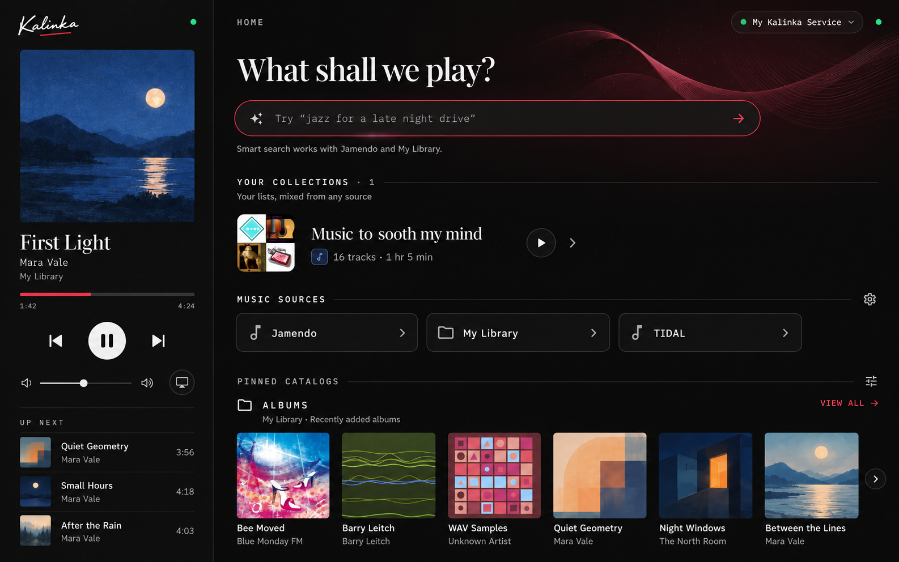
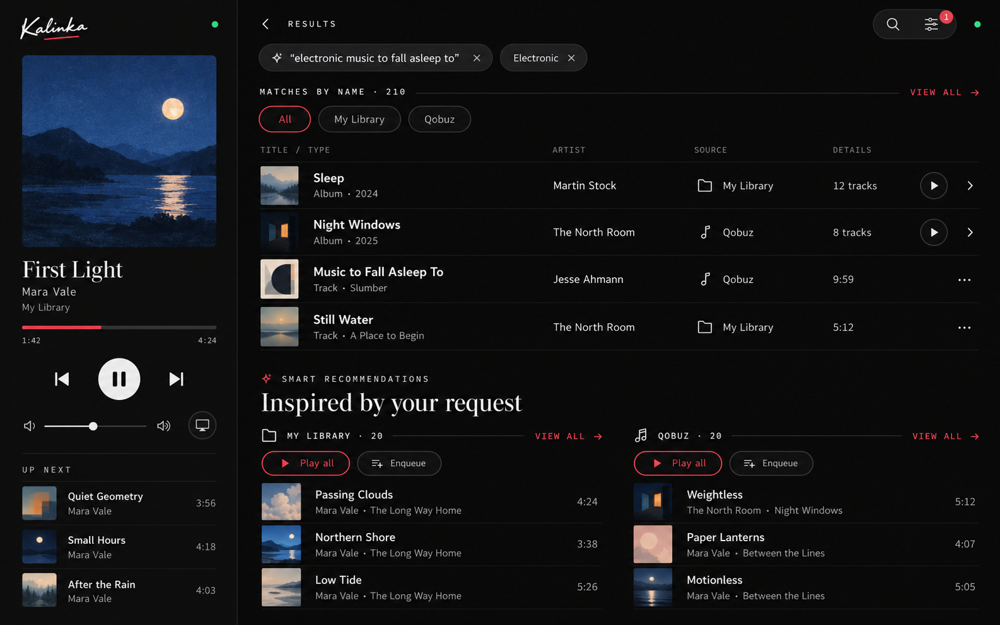
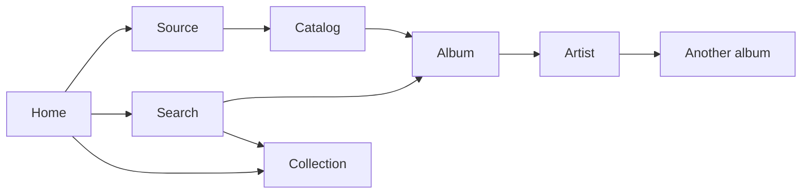

# Kalinka browsing and navigation design guide

Kalinka uses one browsing model across phones, tablets and desktops. Opening an item shows its page, explicit playback actions control the queue, and Back restores the previous visit. Larger screens use a bounded player panel and adapt the browsing content through artwork grids, metadata columns and multiple compact items per row.

This is the implementation specification for the agreed redesign. The interaction rules and page responsibilities below are the target behavior. Dimensions marked as starting values need validation in rendered Flutter layouts before becoming shared tokens. The [implementation status](#implementation-status) section records what has landed.

Use [PALETTE.md](../PALETTE.md) for colours, typography and Home controls, [the settings guide](settings-design-guide.md) for Configuration and Customise Home, and [the Home catalog contract](home-catalogs.md) for capabilities, pins and persistence. This guide supersedes the earlier prototype's navigation and fixed split-layout assumptions. Existing pin formats, source capabilities and settings behavior remain applicable.

## Design decisions

1. Give browsing the growing share of a large window; keep the player at a useful bounded width. Preserve the expanded-player experience for focused listening.
2. Open sources, catalogs, folders, albums, artists, playlists and collections through consistent page navigation. Remove inline expansion of albums and playlists from listings.
3. Use layouts appropriate to the content. Album catalogs benefit from artwork grids; wide lists need useful metadata columns or several compact items across a row.
4. Keep name matching and smart recommendations together in Search. Keep the genre filter panel and its chips, and the name matches' source pills.
5. Keep Home's order: search, collections, music sources, pinned catalogs. Home contains previews; catalog pages contain complete listings.
6. Preserve provider identity, declared capabilities, backend order and complete playback contexts. Add shared backend metadata when necessary; never introduce plugin-name rules in the UI.

## Visual references

The wide concepts illustrate the bounded player, Home shelves, aligned search metadata and source recommendation groups. Their music, counts and artwork are illustrative. The written behavior and repository tokens govern implementation; do not reproduce accidental details, duplicated status indicators or unsupported metadata from generated images.





The [interactive navigation prototype](mocks/browse-navigation/index.html) demonstrates routes, filtering and playback contexts. Its older equal-width panels and some simplified controls are not the final responsive design. The album catalog grid, compact list grid and wide entity pages still need rendered review during implementation.

## Interaction rules

| Element | Primary activation | Separate actions |
| --- | --- | --- |
| Source, catalog or folder | Open its listing page when browsable | Declared filtering and catalog pinning where applicable |
| Album, artist, provider playlist or user collection | Artwork, title, row and right chevron open the same detail page | Play, Play next, Enqueue and editing where supported |
| Track | Start playback with the context defined below | Overflow exposes queue actions and supported album or artist links |
| Home preview | Open its item directly, or its saved catalog through the catalog action | Preserve the selected preview format and saved filters |
| View all | Open the complete listing as a normal navigation destination | Preserve source, query, filters, order and result snapshot |
| Grid or List control | Change presentation on the current page | Preserve filtering, order and the visible item anchor |

A catalog's own `preview_config` says how it shows once opened, not how the listing it sits in draws it. A catalog whose preview type is `folder` opens as a folder page, but only a folder's own listing (a folder page, or a pinned folder's preview) draws it as a folder row; anywhere else, such as My Library inside its source's root, it is drawn like any other catalog.

Opening content never starts, stops or replaces playback. Play buttons remain separately reachable on touch screens and with a keyboard; they must not require hover. Queue actions do not navigate. Track rows do not have navigation chevrons.

A downward disclosure arrow is appropriate for optional information such as a longer description, not for opening an album's tracks inside a result row. Selection mode is explicit: its toolbar explains the mode, row activation selects, and Done or Cancel exits it. Retain existing collection-edit guards and confirmation behavior.

Use `canBrowse`, `canAdd` and `canEdit` through shared action resolution. An item that is unavailable or lacks an action must not display an enabled affordance for it. Existing collection ownership metadata determines collection identity; editability alone does not distinguish collections from provider playlists.

## Navigation and state

Each destination the rail lists — Home, Search results, each music source and Collections — owns a history stack of its own, kept as it was left while another is shown. The player remains independent of these stacks.



The diagram shows entry paths, not a fixed breadcrumb hierarchy. A page opens in the destination it was opened from, whatever its source: an album opened from Search belongs to Search and returns to it; an album opened from a Home pin belongs to Home. The rail marks the destination, not the shown page's source. Choosing another destination on the rail shows it as it was left, scroll and filters included; choosing the one shown does nothing. Without the rail there is nothing to switch between: opening a source from Home starts it at its own page, and Search results reopen at the results themselves. The stacks underneath are the same, so resizing across the rail's threshold keeps the shown page. Artist links stay with the returned source identity. Folder breadcrumbs represent actual ancestors. Do not display a fabricated `HOME > current page` path for every destination.

Each visit retains the typed item and exact ID, source identity, applicable query and filters, selected artist tab, Grid/List preference, local name-match source, loaded pages or result snapshot, and scroll/focus anchor. Use an item or occurrence ID plus its offset so resizing a grid can restore the same item even when the column count changes.

Back first dismisses the top overlay. With no overlay, it exits a transient selection mode or follows the existing edit guard, then returns to the previous page in the same destination. At the first page of Search results, a source or Collections it goes to Home as Home was left; at Home's top it leaves the app. Filter cancellation discards staged edits. Toolbar Back, system Back, browser Back where supported and platform gestures must follow the same rules.

Filtering, local source selection, artist tabs and presentation switches do not add history entries. Opening a complete listing or another entity does. A new search replaces Search results' whole stack; the destination it was started from keeps its own, and dropping the search returns there. Phone/tablet transitions must preserve the stack and playback.

### State lifetimes

| State | Lifetime and boundary |
| --- | --- |
| Applied search filter combination | Keep existing device preferences; remember selections without saving the previous query as a filter |
| Search query, results and applied filters for a visit | Retain with that visit; later preference changes do not rewrite older history entries |
| Source shortcut within name matches | Temporary state of that results visit; never a saved global filter |
| Catalog filters | Preserve the existing category-specific scope and server separation |
| Grid/List choice | Remember per compatible listing family; scope catalog overrides by server and stable catalog ID if introduced |
| Home pins | Preserve existing per-server storage, preview formats, filters and user ordering |
| Queue and playback | Independent of browsing layout, filters, routes and view preference |

## Responsive application layout

All measurements are Flutter logical pixels. A screenshot's physical resolution does not determine its layout mode. Use the window constraints for the shell and the actual available pane width, text scale and content for its children.

### Shell and player

| Available space | Target behavior |
| --- | --- |
| Below 720dp wide or 480dp tall (a phone on its side), or above 1.5× text | Existing Home, Back and server-menu navigation above the mini-player, without a drawer; the full player opens from the bar |
| From 720dp, without room for two usable panes | An 88dp navigation rail, browsing and the mini-player; the player opens as a sheet beside the rail, which stays in view and closes the sheet when used |
| Room for browsing and player | The same rail and browsing stack, with a bounded persistent player at right |

The whole shell keeps clear of side insets, such as a phone's camera cutout when it is turned, with the canvas colour filling them. The player takes 30% of the window width, bounded to 432–440dp. Split only at or above 900dp when at least 520dp remains for browsing after the rail, player and 1dp divider (so from 1041dp at standard text size, and a 1024 window keeps the mini-player); increase that minimum with system text scaling. The 900dp boundary still controls the existing page gutters. At intermediate widths and large text sizes, use the mini-player, whose minimum 72dp height grows to accommodate both metadata lines. Its controls respond to the available width and text size.

Keep Home and Results at the top of the rail, followed by the available music sources, with Configuration anchored at the bottom when supported, followed by Restart, Change server and Power off (Restart and Power off only where the streamer offers them; Change server not on web). Power off's icon is berry. When the window is too short for all of them to stand under the rest, as many as fit stand and the rest go behind a **More** (⋯) item, whose shelf unfolds to the rail's right, level with it, holding them as rail items side by side; picking one, or a tap anywhere else, folds it again. Change server is marked as the current destination while the server picker shows, and any other destination cancels the picker on the way. On a window too short for both groups the whole rail scrolls. Rail icons are 24dp with visible 12dp labels under them; a music source's icon is drawn in that source's colour, as its badges are, and goes muted with the label when the source cannot be browsed. From a 1280dp window the rail widens to 200dp, growing with text up to 1.3× (narrow beyond that), and sets each icon beside its full name in 16dp. Phones retain source tiles on Home and Configuration in the existing server menu. The source list scrolls on short windows. Items are plain rectangles spanning the rail edge to edge. The selected destination has a 2dp crimson rule down the rail's right edge, as tall as the item, and selected semantics; keyboard focus uses a distinct primary-colour outline. Targets are at least 48dp. Home source tiles remain useful shortcuts to the same routes, not separate filters. Preserve the browse visit, scroll state, playback and pending-edit guards when navigating or resizing. Configuration and Customise Home occupy the browsing pane, and sheets and dialogs respect its rail inset. Configuration opened from the rail, or from Customise Home, is switched to in place like any destination, without the slide-in, and leaves in place too.

Results returns to the last search without submitting it again, preserving its query and filters even when disconnected. Until a search has run, the destination is disabled with an explanatory tooltip. Opening the search composer does not select Results; the current page remains selected until a query is submitted. The query appears in the rail destination's tooltip, replacing the former Home return-to-results banner. Without a rail, a 48dp **Back to search results** icon action appears in Home's header once a search exists; do not introduce a hamburger menu or drawer. New searches start from Home's search entry. Use **Config** in the compact rail, with **Configuration** in its tooltip and accessibility label.

Keep artwork proportional and bounded by available height as well as width. Align the Now Playing content to the top, leaving 32dp below the header, and keep the cover, track identity and controls together. Where the pane is wide enough to set the cover beside the details, only 8dp are left, so the height-bound cover grows, and the title, artist and album grow with the width beside it (in step from 260dp, up to 1.6×) as far as the cover's height holds them with the output beneath; the stream line keeps its size. In the phone header, Minimise stays on the left and the fullscreen action stays on the right at every width and text size, including when the Playing/Queue tabs move to their own row. Queue options occupy the same right-hand slot in Queue view. Short windows and enlarged text use a smaller cover and scrollable controls. Preserve output selection, volume, transport, Playing/Queue access and playback errors.

After the controls, show **UP NEXT** and the total number of upcoming tracks only when the remaining viewport can accommodate the heading and at least one complete preview row. Fit one to five rows, using the actual measured content height and system text size; never shrink the artwork or push controls offscreen to make room for the preview. At the end of the queue the heading stays, over **Queue is empty** as the queue's own Up Next shows it; with an empty queue or a plugin's exclusive playback there is no section. On the phone's sheet, where the cover leaves no room, Up Next follows the controls below the fold with up to five rows; a downward drag from the top of the content hands over to the sheet, so swiping down still closes it. Show the next occurrences after the current index in the server-reported queue order, excluding the current and previous tracks. The heading opens the full queue. Each row shows small artwork, title, artist and duration, and plays that existing queue occurrence without replacing the queue. Where the queue would show its Album column — the same width threshold, scaled with text size — the rows show it too, and a TRACK / ARTIST · ALBUM · TIME legend under the heading names the columns, aligned with the rows as in the queue. Keep the preview neutral, keyboard-operable and readable with image fallbacks; disable playback actions while disconnected or for unavailable tracks. Hide it for an empty/finished queue and while a plugin controls playback exclusively.

Every overlay must use the actual owning pane bounds. Audit existing half-window positioning when changing the split, including settings, renderer settings, discovery, search filters, pin sheets, dialogs and toasts. Configuration and Customise Home continue to occupy the browsing pane on tablets and desktops. Playback remains usable beside nonmodal management pages.

### Content sizing starting values

| Element | Starting point for rendered review |
| --- | --- |
| Album catalog artwork | Approximately 180–220dp square; add columns as space grows |
| Home Cards shelf artwork | Approximately 150–180dp square; preserve its horizontal preview behavior |
| Compact list item | Enough width for artwork, readable title/metadata and actions; initially test around 360–440dp |
| Two recommendation groups | Each needs around 400dp plus a 24–32dp gutter; test against the browsing content width after outer gutters |
| Wide list metadata | Add columns only when title, metadata and action minimum widths all fit; otherwise combine secondary details below the title |
| Album detail side layout | Cover/metadata beside tracks only when both remain readable; otherwise stack the identity header above tracks |

Increase card height for wrapping and text scaling rather than shrinking type. At very large widths, add useful grid columns, then bound remaining content widths when needed. A lone collection or short source name does not need to stretch across the pane.

## Lists and grids

List presentation supports two distinct ways to use width. Select the treatment by the kind of content and its ordering requirements, not by plugin name.

Use the same neutral highlight for list items in pinned Home previews and catalog pages: a flat, subtle white overlay across the entire row, including its artwork and actions, with no frame, outline or extension into the gutters. Show it immediately on hover or keyboard focus, and strengthen it while pressed. Keep the hand cursor, existing padding and selected/playing marks. Highlight feedback must not intercept taps, swipes, long presses or trailing actions. Disabled rows stay unhighlighted. With a mouse, on desktop and web, a Ctrl- or ⌘-click does what a long press does (selects a track or container, or puts a suggestion in the field to edit), claimed as the button goes down, so a plain click opens or plays at once with no double-click timeout to wait out; the row's own buttons keep their clicks. A track row wide enough for its Album column (576dp, scaled with text size) ends with a grey round + after its time, the row play button's size (its room kept while it hides, so times stay under TIME), which adds the track to the end of the queue: it turns to a muted check at once and takes no more clicks while Enqueue would show Added (3 seconds), reverting straight away if the add fails. It hides during selection, like the play button.

### Metadata columns within one row

Use this for ranked mixed search results, track listings, full recommendation lists and the queue. Examples of useful column sets are:

- Mixed results: title and entity type, artist or owner where applicable, source, track count or duration, actions.
- Tracks: position, title, artist, album when relevant, source when mixed, duration, actions.
- Albums in an information-focused list: title, artist, year, track count or duration, source when mixed, actions.

Keep one visual and semantic order from top to bottom. Column labels describe what the data means; mixed counts and durations belong under a neutral label such as Details. Omit unavailable values and avoid columns that are empty throughout the listing. A metadata column is not automatically a new sorting control.

On narrow panes, fold secondary fields into the title area in a stable priority order. Keep the identity and primary actions readable. Do not force horizontal scrolling for an ordinary track list or spread a title and its main action across an excessive empty gap.

### Multiple compact list items per row

List is always a table: album, artist, playlist, collection and category indexes keep one row per line with aligned columns, whatever the pane's width. Only Grid sets items across, as cover cards, and tracks in a grid as rows across its columns, since a track has no card.

```text
Compact entity list on a wide pane

[art] Album A   Artist A   Play  >    [art] Album B   Artist B   Play  >
[art] Album C   Artist C   Play  >    [art] Album D   Artist D   Play  >
```

Read left to right, then top to bottom, preserving the supplied item order. Keyboard and screen-reader traversal follow that same order. Use equal column widths and align items in each row to its tallest content. Avoid masonry, independent column scrolling and stretching the last lone item to full width. Collapse to one column when names, actions or text scaling need the space.

Ranked mixed search results and ordered track sequences use metadata columns instead of this compact-item arrangement. Independent recommendation source groups may sit side by side, but each group keeps its own ordered list and complete playback context.

### Presentation defaults and preferences

| Listing | Default | Alternative |
| --- | --- | --- |
| Homogeneous album or artist catalog | Artwork grid, framed as a Home card rail: covers 22dp apart, frames abutting, and the whole card outlined under the pointer, held or focused; Play shows on the cover while the card is lit, and always without a mouse | List; adapt between compact items across rows and metadata rows according to the shared template |
| Playlist or collection index | Compact entity items | Artwork grid when artwork and the listing support it |
| Source categories and folders | Compact navigable items | Declared catalog layout where applicable |
| Mixed catalog or name matches | Mixed typed rows | Add metadata columns with space; do not regroup or reorder implicitly |
| Tracks, playlist contents, collection contents, full recommendations | Ordered rows | Add metadata columns with space |

Expose a compact, labelled Grid/List control only where both presentations are useful. Draw it as one 40dp stadium pill in the chrome of Play all and Enqueue, give each choice a 48dp target, and distinguish the selected choice with a neutral raised inner pill, outline and brighter icon. Keep the user's explicit choice when resizing; the chosen view adapts internally. Store presentation independently of filters and Home preview preferences. An album catalog opening as a grid must not convert its pinned Home Cards rail into a grid.

Catalog category cards are 3:1 cards with the catalog's name on the art, as Home's Artwork draws them (see PALETTE.md, *Catalog art*). The `aspect_ratio` of its large image decides how its art sits: art of the card's 3:1 shape covers it, any other shape sits whole on the right of a card drawn from the catalog's title and description. The parent preview's `aspect_ratio` describes its children and never shapes a card, since one listing may mix kinds. A catalog with no art, or while its art loads, shows the drawn card. Rows lead with the catalog's square thumbnail. Allow at least 220dp of card width per category column before text scaling when the viewport permits, using preview metadata or the loaded item types to identify category listings. Album and playlist cards take the shape their shelf's `preview.aspect_ratio` declares, square by default; artist portraits stay round. Each cover's own `aspect_ratio` only says how it fits its card: matching, it covers it; otherwise it sits inside whole over a soft, darkened fill of itself, never cropped. A shelf declaring wide covers takes the category column widths. Suppress repeated badges and the Source column inside catalogs whose loaded items all share the source named by the header. Keep attribution for mixed-source listings and outside that catalog context.

## Home

Keep the sequence Search → Music sources → Your collections → Pinned catalogs. Where the left rail shows, Home drops the line of sources (gear included) and Your collections: the rail lists the sources, Collections and Configuration instead. An empty Home (no pins and no collections, a collections list still loading counting as none) shows no banner. The question, the search entry, its suggestions when there are any and the line of sources (shown then even where the left rail shows) sit centred in the pane, the crimson bloom centred behind the search with them, followed by a pin glyph, **Pin any catalogue or saved search to see it here.** in `textSecondary`, and a neutral **Customise Home** text button with the tune icon. Once the first pin or collection arrives, the hint goes and the whole block, bloom included, glides to the top (450ms, ease in-out; at once under reduced motion) to make room for the sections. Centring leaves out the mini-player's slot while it slides away under the search, so its coming back moves nothing. Home doesn't promote collections for now: Your collections shows only once there is at least one (nothing while the list loads), with no invitation to make the first. Future contextual suggestions are outside the reorderable pin list and are not introduced by this redesign.

- Search retains **What shall we play?**, the entry field and the applicable source-support note. Keep no introductory paragraph. Centre the heading, field, note and prompts, bound the search field to a readable width on a wide pane, and keep the Home-only crimson artwork balanced around a quiet centre for search.
- Collections use compact items with actions beside their content. Multiple collections may fill several columns; one collection stays compact. Show **View All** only when the total exceeds the displayed items.
- Home’s sources are one line of names at 16dp ending with the **Configure music sources** gear, centred while it fits and otherwise scrolling sideways with faded edges like the prompts; a name lights under the pointer and opens its source, folding the hero away first. Customise Home keeps the source tiles: they show the declared icon, name and right chevron, with no description. Use equal dimensions and wrapping; the tiles share the whole width, in as few and as evenly filled rows as fit, a lone source spanning it. Limit width-driven enlargement of their text, icons and padding to 10%; system text scaling remains independent and labels wrap. The **MUSIC SOURCES** gear opens Configuration → Music sources through the existing capability check.
- Bound the search entry and its composer to 575dp, centred, with 40dp prompts under it. Keep search, sources, collections and pins in that order.
- Give the pins no group heading. After the last, right-aligned, show a muted **Want Home to look different?** and a neutral **Customise Home** text button, only when pins exist. Each pinned heading starts with its source's tile instead of a pin, and its **View All** is a small neutral link. With no pins, Home shows no customisation banner; only an empty Home carries the pin hint.
- Preserve user pin order and all four formats. Cards stays a horizontal rail, running out to the pane's edges and fading (up to 32dp) at either edge with more to scroll that way, as the suggestions and sources lines do; Artwork uses the pinned item's own artwork and caption; List shows up to five items; Compact uses source-tinted tiles. Adjacent Compact pins may share a row without changing order. Do not pair unrelated full pinned sections merely to fill a wide row.

Retain the detailed pinning and customisation behavior in [home-catalogs.md](home-catalogs.md) and [PALETTE.md](../PALETTE.md#home-catalog-headings), including artwork proportions, text treatment, source attribution, separators and confirmation. Home preview selection and catalog Grid/List selection serve different purposes.

## Search

### One query and two responses

Keep **Matches by name** followed by **Inspired by your request** when both have results. A query can produce both responses; there is no classifier deciding whether it is a title, artist, mood or activity request. Explicit user filters may narrow what is shown or requested through the existing session behavior.

Name matches remain one mixed list of returned artists, albums, tracks, playlists and collections. Keep the existing order during the navigation redesign and label types clearly. The initial overview shows four matches with **View All** when truncated. Do not introduce entity-type tabs, a mandatory top result or separate Artists/Albums/Tracks shelves. When more than one source found something, a line of source pills sits under the heading: **All** stays put at its start, and the sources after it scroll sideways out to the pane's edge, fading wherever there are more. The source picked last is remembered on the device and picked again by the next search when it found anything (else All shows).

Recommendations remain a separate ordered list from each supporting source, with up to 20 tracks per returned snapshot. Each group shows its source, actual count, Play all, Enqueue and three preview tracks. Show **View All** only when additional tracks exist. Sources without smart-search support have no recommendation group. **View All** on either block opens it in full as a page of its own, named in the bar (**Name matches**, **Recommendations · Qobuz**), with no chip; Back returns to the overview.

On wide panes, place two recommendation groups side by side when both fit. A third group wraps into the next row in source order at the same bounded width. Keep one browsing scroll surface and no masonry. Full recommendation lists use a normal detail/listing destination and a single ordered track list.

### Global filters and local source selection

A catalog's search narrows its listing: the bar's field (from 720dp, else a button that unrolls it under the bar), applied on Enter, beside **Filters**, both in the bar from the first frame. A results page's query is not a filter but a search of its own, so it is changed where it was made: the query is the bar's title, quoted, in the bar's uppercase mono (no chip, nothing to dismiss; Back leaves the search), and tapping it or the bar's search button raises Home's smart search holding it, its suggestions and history with it. Results keep **Filters** in the bar for what kind of music (artist, album, playlist, track) and genre, each while the results hold more than one, and their card holds no search field; sources are the name matches' pills and a block opened in full is a page. A filter belongs to the search it narrowed: Back into that search, or Results in the rail, finds it as it was left, while a new search, a cleared one and the next session start without one. Pin sits immediately beside the catalog title and moves with it into the top bar when the identity collapses. The Filters card edits the supported facets and stages changes until **Show results**. It hangs from the bar's right, under the pills, at most 480dp wide and 640dp tall (scaled with text size), so on a large pane it stays a card rather than a page. Where its facets outgrow it, the body scrolls between the header and the footer, its top and bottom edges fading (up to 24dp) as far as there is more to scroll that way. Cancel, Escape, outside dismissal and Back discard staged changes. Applying facets preserves the current search; an explicit Reset clears it too. Only sources that declare catalogs are searched, with the server's own collections, which answers by name without declaring any; others have nothing to find, so they are neither asked nor offered as filters. Results leave 21dp under the bar before the first section, as catalog shelves do. Results are slivers: a block opened in full builds only the rows in view, so switching its source or resizing the window costs the same whatever its length.

Applied chips above results display the current filter combination. Where catalog search is already visible in a field, omit its duplicate chip. Draw them as the filter card's own pills — 40dp tall with 14dp primary text, a leading glyph where one applies and a trailing remove mark — in 48dp targets, growing with text scaling. Place **Clear filters** immediately after the chips in the same wrapping group; it clears facets while retaining the search text. Keyboard activation and full-label tooltips remain available. They use neutral receipt styling; removing one changes only that filter. Selected options inside the panel use the palette's crimson decision styling, with appropriate selected semantics. The closed filter pill remains neutral with a small active-count badge.

Within a search, retain desired selections while requests are pending and keep a facet the results cannot show yet as the choice, so it applies once a source that answers late brings it; do not silently erase it because a source is loading. Genre vocabulary and combination semantics come from the shared filter contract. There is no requirement for new named presets.

The **All / source** shortcuts under **Matches by name** are separate temporary state. They narrow only the name-match list after global filters. Recommendations remain visible. Offer sources with matches, hide the shortcuts when only one source remains, and reset an invalid local selection when global filters exclude it. Back restores this local selection; a new search does not inherit it as a global preference.

### Multiple sources and collections

Design for two or three music sources without introducing a separate browsing tree for each result group. In mixed results, show readable source names with icons. On a dedicated source-owned entity page, show attribution once in its identity area and avoid unnecessary repetition on every child.

Identical names from different sources remain distinct items with exact returned IDs. Opening an artist link or playing a release preserves its source. Cross-provider merging or substitution requires reliable backend identity and edition matching; it is outside this redesign.

Collections are user-owned ordered mixes. Their search origin is the built-in collection source, not the first contained track's source. Opening a collection always shows the full mix; search-origin or genre filters must not trim its contents. Show actual track origins inside the collection. Use the existing collection ownership resolver and shared metadata; request a shared discriminator if a generic result cannot identify ownership reliably.

### Loading and ranking

Preserve successful responses when another source fails. Recommendations can appear independently of name matching. Keep the merged name list stable as sources settle; preserve the current merge policy until a separately tested replacement exists. Use per-source Retry and matching placeholders, retain empty-state filter controls, and reject late responses from older queries.

Ranking quality is a separate workstream. Review representative real queries against their exact returned results before changing order or making stronger relevance promises. Layout changes must not invent scores, infer intent or imply that recommendation quality has improved.

## Catalog and entity pages

### Source and catalog

Use the provider's declared categories, subcatalogs and filters. A homogeneous album catalog defaults to an artwork grid; a generic mixed or unknown catalog retains a usable listing. Infer presentation from shared item types, declared sections and preview metadata, never localized category names.

Show catalog title, optional description, source attribution, applicable filter controls and Pin when eligible. A paginated listing continues scrolling without an extra View all step. On a sectioned catalog overview, a truncated section's **View All** opens its actual declared catalog and applicable filters. Hide the action when the complete section is already shown.

Use a shared collapsing header for every catalog and playlist page. Place Pin immediately beside the Playfair title, with attribution 4dp below. The identity starts directly under the top navigation; the header holds nothing else but a folder's own actions, beside the identity where it keeps its natural width (the title wraps to two lines only past 320dp), else 8dp below it. The divider sits 12dp below whatever ends lowest. Separate this grouped header from the listing with a 1dp neutral divider aligned to the 16dp content gutters, without another toolbar below it. Keep only supported controls. **Filters** is the bar's on every catalog page as on results, a round glyph pill badged with how many are on, from the page's first frame. Search is the bar's too, however far it has scrolled, so a search reloading the list never moves it: from 720dp of pane width (scaled with text size) the field itself sits in the bar, at most 360dp and 40% of the pane; below that the bar holds a round search button (a dot while a search is applied) that unrolls the field under the bar across the pane, focused, and puts it away on Enter, a scroll, Back or the button. Either searches on Enter, not as it is typed, and its clear button resets at once. Where no field shows the search, it is a chip of its own, first among the applied filter chips. Grid/List is the bar's as well, last before the server chip from the page's first frame, so switching never moves it; it folds to one button that switches to the other view where the pane is under 600dp. The bar reads Back, the title, Pin, Search, Filters, Grid/List (set 12dp further apart, as it only changes how the listing is shown) and the server chip; only the title and Pin join it on scroll, ahead of the rest, so nothing else moves. Nothing stays pinned under the bar but the divider (and a folder's Play all, Enqueue and Up one folder, held under the bar). The identity scrolls with the page and slides under the bar; once the title has passed out of sight, it appears beside Back in the standard uppercase mono top-bar font with Pin. Scrolling back to the top returns them to the expanded header. While the large identity is expanded, omit the small top-bar title. Preserve applied filters and collapsed state when navigating Back. Folder pages show their trail in the bar and pin folder actions beneath the bar. A playlist, and a catalog that declares `can_add`, carries Play all and Enqueue under its identity; the server queues a catalog whole, so while a filter, search, sort or chosen kind narrows its listing they stay in place, disabled, with a tooltip to clear the filters.

During collapse, transfer the title and Pin before the title reaches the viewport edge. Let source attribution follow it up without overlapping the filters. Fade the header surface with scroll distance; do not switch a transparent header to an opaque rectangle on the first scroll event. The top bar above it, status inset included, takes on that surface at the same pace, so once collapsed the bar and the pinned search and Filters read as one surface over the catalog art. Keep every visible control above the divider throughout the transition, and decide filter-row wrapping from width and text size rather than scroll position. Pin stays with the identity. If there are no persistent filters or folder actions, collapse to the divider alone. Check intermediate scroll offsets in both directions, including catalogs with only Pin and enlarged text.

An opened playlist or collection shows its complete ordered track listing directly, fetched and built in chunks as it scrolls. Ignore preview sections on these detail pages and do not add a **View All** step. Playing a row still queues the full playlist by its ID and starts at that occurrence, including tracks not yet loaded. Album and artist detail layouts retain their own identity headers.

### Album

Preserve the square cover, title, source, linked artist, known year, track count and duration. Show Play album, Enqueue and supported overflow actions above complete ordered tracks, with disc grouping when supplied. Optional album information stays on this page. A wide identity column can sit beside the track table; a narrow pane stacks them. Use one scroll viewport for the entire album page: artwork, details, actions and tracks move together, including loading, empty and error states. Keep tracks lazy-built and paginated within that shared viewport.

Missing metadata must produce a compact useful header, not empty labels or an unnecessarily large banner. Artist navigation requires a returned stable relationship. Additional credits, label, booklet, edition and release-quality information depend on shared optional metadata, not title parsing or the current player's signal data.

### Artist

Show portrait or fallback, name, source and known album count. Albums is the initial complete paginated relation when available. Offer Tracks when declared; About requires actual biography data. If only one relation exists, show it directly without an empty tab set. Preserve other provider-declared relations through their returned labels until shared typed relations are available.

Artist tabs switch content without adding history entries. Albums and Tracks use their appropriate complete views, replacing the current pattern of two short lists that both require View all.

### Playlist and collection

Show cover or collection mosaic, title, description, owner when known, count and duration, then the full ordered tracks. Keep provider playlists distinct from user collections and expose editing only when supported. A collection's source summary may describe the mix; each track retains its actual origin.

Use metadata columns at wide sizes and compact rows at narrow sizes. Preserve duplicates as distinct occurrences and provide existing editing, selection and reorder controls. Browsing into an entity must not lose pending collection edits.

### Folder

A folder page is one history entry however far its folders are walked: moving into a folder, up a level or along the trail changes what the page shows in place, and Back leaves the page. The trail preserves the real path and sits in the top bar after Back, in place of the page's title, its last crumb the folder shown; declared actions stay. Keep subfolders and tracks understandable using the provider's ordering contract. Folder layouts remain catalogs for pin eligibility where the shared model declares that relationship.

## Playback contexts

| Action origin | Required playback context |
| --- | --- |
| Album Play or a track within an album | Complete ordered album; a track selection starts at that track |
| Playlist or collection Play or track | Complete ordered container, including source identities and duplicate occurrence identity |
| Recommendation preview or full recommendation list | That source's complete returned filtered snapshot, up to 20 tracks; start at the chosen track |
| Isolated track in mixed search results | That track; do not treat adjacent albums and artists as a playable queue |
| Queue row | Existing queue occurrence; do not rebuild the queue |

Play replaces the playback context, Play next inserts after the current occurrence, and Enqueue appends. Use container IDs when the backend can expand the intended complete context correctly. A loaded preview or first page must never be mistaken for the whole container.

For starting a particular track in a paginated container, resolve the complete ordered context and stable occurrence before changing playback, or add a shared backend operation that accepts container/filter plus start occurrence atomically. Keep pending and failure feedback visible. Never apply an index from a partial page to a differently expanded queue.

Search filters do not alter the contents of an album or collection after opening it. Preview playback, however, must respect the actual recommendation snapshot and any explicit supported filtering that produced it. Different source groups never merge automatically into one recommendation queue.

## Backend and model boundaries

| Requirement | App work | Shared contract work when needed |
| --- | --- | --- |
| Richer entity pages | Carry the full typed `BrowseItem` into the route and refresh through `getMetadata(id)`; retain already supplied album/artist/playlist fields | Optional credits, release details, biography and release-format metadata |
| Artist relations | Render typed, declared relations and retain generic unknown sections | Stable relation descriptors if the current response cannot distinguish albums, tracks or other relations reliably |
| Collection identity | Use existing built-in ownership metadata and resolver | Explicit shared ownership/entity discriminator if generic results remain ambiguous |
| Correct playback start | Preserve complete context and occurrence IDs | Atomic context/start operation or explicit occurrence identity if the current API cannot guarantee it |
| Source and catalog layout | Use shared capabilities, item types, declared filters and sections | Provider fixes to expose missing metadata or declarations through the SDK |

Home tiles continue to require the explicit `catalogs` capability. `ai_search` is independent; ordinary name search is not gated by either Home catalog availability or smart suggestions. Keep the shipped SDK 3.14 capability and REST API 0.18 pagination contract from [home-catalogs.md](home-catalogs.md), without adding an API-version UI gate. Read all root pages through the shared helper and use returned IDs verbatim.

Catalog audio quality and actual output quality are different data. Display format or resolution only when the relevant release, track or playback response supplies it. Do not derive lossless, hi-res or bit-perfect claims from provider names, filenames or unrelated playback state.

## Visual and accessibility rules

Use existing semantic colour and typography tokens. Playfair Display identifies editorial and entity titles; IBM Plex Sans carries names and metadata; uppercase IBM Plex Mono identifies sections. Preserve the palette's fill-or-outline rule and neutral applied-filter chips. Use source colours through shared module metadata only.

Keep 32dp between major Home sections and 12dp between headings and their content. Validate comparable rhythm on entity pages. Do not add card shadows. Align metadata and actions deliberately; empty space is acceptable when additional content would not help a decision.

All actions have readable labels or tooltips, native selected/disabled semantics and targets of at least 48dp. Keep visible keyboard focus, stable hit areas, semantic row/column relationships and predictable traversal. Artwork beside a readable item name is decorative; standalone meaningful images need accessible identification.

Respect text scaling without clamping. Reflow controls and columns before truncating essential identity. Honor reduced motion and safe areas. Preserve title and artwork space during loading; reuse Home shimmers and matching list/grid skeletons. Unknown totals are not zero, and loaded subtotals are not complete counts.

## Implementation sequence

Each stage produces a reviewable change and passes its relevant acceptance journeys before the next behavior migration.

| Stage | Deliverable | Completion evidence |
| --- | --- | --- |
| 1. Validate the responsive compositions | Render wide album grid, compact list grid, metadata list and album detail alongside Home/Search; tune shared width tokens | Phone, narrow tablet, wide desktop and large-text review; no clipped actions |
| 2. Preserve complete visits | Introduce typed destinations and visit state through the existing search-session boundary | Search/catalog/entity/artist/Back restores metadata, filters, snapshot, focus and item anchor |
| 3. Unify open and play | Route every browsable row/card through one open action; remove inline container expansion after equivalent navigation exists | Same entity opens identically from Home, search and catalogs; explicit Play does not navigate |
| 4. Adapt the shell and listings | Bound the player, audit overlay anchors, add responsive grids, compact items and metadata columns | Resizing preserves playback and the current visit; Grid/List persists independently of pins |
| 5. Build entity templates | Album, artist, playlist, collection and folder pages with real available metadata | Complete relations and ordered tracks; missing metadata and unsupported actions behave correctly |
| 6. Integrate Home and Search | Preserve Home order and pin behavior, existing filtering and local source selection; adapt recommendation groups | Two and three source cases, source failures, saved combinations and mixed collections verified |
| 7. Verify playback and retire legacy state | Audit complete-context commands, pagination and duplicate occurrences; remove unused expansion paths | Queue assertions, paginated start-track tests, no obsolete behavior exceptions or stale documentation |

Correct playback context is a gate for migrating any Play action in stages 3–6; stage 7 is the final audit, not permission to defer correctness. Backend contract additions can proceed separately, with unavailable optional information omitted until supported.

### Code entry points

- [music_player_screen.dart](../lib/screens/music_player_screen.dart): shell split, player hosting, management overlays and pane bounds.
- [search_session_provider.dart](../lib/providers/search_session_provider.dart): query/filter preferences, local source, catalog metadata, expanded sections and history migration.
- [search_session_view.dart](../lib/widgets/search/search_session_view.dart): browsing chrome, page hosting and search overlay anchors.
- [ResultsView](../lib/widgets/search/results_view.dart), [NameMatchesBlock](../lib/widgets/search/name_matches_block.dart) and [InspiredBlock](../lib/widgets/search/inspired_block.dart): preserve the two response sections and their different source-selection scopes.
- [BrowseNavigationScope](../lib/widgets/search_cards/browse_navigation_scope.dart): `openBrowsable` is the one open action for every row and card.
- [browse_detail_provider.dart](../lib/providers/browse_detail_provider.dart): audit page completeness; its bounded fetch cannot serve as proof that a container is fully loaded.
- [data_model.dart](../lib/data_model/data_model.dart) and [browse_filters.dart](../lib/data_model/browse_filters.dart): typed metadata, capabilities, filters and shared contract extensions.

There is no requirement to replace the router package or rewrite unrelated settings. Preserve uncommitted work and migrate one coherent behavior at a time.

## Acceptance journeys

| Journey | Pass condition |
| --- | --- |
| Home pin → album → artist → another album → Back repeatedly | Each visit restores its own content and position; final Back returns to the originating Home preview |
| Search → album → Back | Query, global filters, local source shortcut, full results snapshot and focused item are restored |
| Filtered album catalog → Grid/List → resize → album → Back | Filters and item order are unchanged; the same visible item is recovered and the saved presentation remains selected |
| Wide compact entity list → keyboard traversal | Reading/focus order is left to right, then top to bottom; every action remains reachable |
| Pick Qobuz in the name matches' pills, then search again | Qobuz is picked again where it found anything, else All |
| Select Qobuz under name matches | Only name matches narrow; other successful recommendation groups remain visible and saved global filters are unchanged |
| Change staged filters, then Cancel, Escape or Back | Results and preferences remain unchanged; only the overlay closes |
| Open a complete name-match or recommendation list | It has a proper Back destination; opening it does not overwrite saved global filters |
| Two/three sources, one slow or failing, one without smart suggestions | Successful results persist, order is stable, retry is local and unsupported recommendation groups are absent |
| Play a track from a three-item recommendation preview | The queue contains that source's complete returned snapshot, starting at the selected track |
| Play from page two of an album or playlist | Earlier pages are included in the correct ordered context; duplicate occurrences select correctly |
| Open and play a collection found through Search | The complete mix and order remain intact, with correct per-track source attribution |
| Disable a source or remove a catalog | Saved pins survive; unavailable content has clear state and no false enabled action |
| Empty, partial and complete Home data | No empty pinned heading; collection View all appears only when needed; placeholders match the eventual layout |
| Resize with a filter, pin picker or settings panel open | Overlay remains within the correct pane; Back closes the uppermost surface; playback remains intact |
| Sparse album and artist metadata | No empty About tab, invented quality badge or unrelated provider-specific fallback; available tracks and relations remain usable |

Run `flutter analyze` and targeted navigation, filter, paging, Home and playback tests for the changed code. Include `browse_root_test.dart`, `catalog_sources_test.dart`, `pinned_catalogs_test.dart` and `catalog_home_ui_test.dart` when those surfaces are affected. Validate 320/375dp phones, landscape, the existing tablet boundary, 1440/1920dp desktops, normal and enlarged text, reduced motion, keyboard use, long names and image failures. High-density physical pixels alone are not a separate breakpoint.

## Decisions to validate before implementation completes

- Final player width range, minimum usable pane widths, card sizes and thresholds for compact items or recommendation columns.
- The exact information/compact treatment of List on each homogeneous catalog family; keep the Grid/List control simple and test with realistic names and metadata.
- Which artist relations, collection ownership fields and playback occurrence guarantees need shared backend additions.
- Search ranking and recommendation relevance, evaluated separately with real queries; this does not block a consistent navigation model.

Do not reopen the agreed basics through these tuning decisions: combined Search, saved filter combinations, source-specific recommendations, Home ordering, capability-driven behavior and consistent page navigation remain the design foundation.

## Implementation status

Landed:

- Shell: the player pane sits at the window's right, bounded by `kalinkaPlayerPaneWidth` (30% of the window, 432–440dp), with an 88dp navigation rail (200dp from a 1280dp window, icons beside names) and a browsing pane of at least 480dp, increased with text scaling; dialogs, toasts, sheets and Customise Home follow the same split, and the queue bar's sheets open over the player's pane. A sheet is at most 640dp wide, centred on its pane. Home has no header artwork for now: a subtle crimson radial bloom glows around the search entry and its prompts, fading out before the bar and the pane's sides; a catalog page's art backdrop fades out over its last 165dp before the player's pane rather than ending at the divider. The resting search entry is centred and at most 575dp wide, and the overlay rises out of it at its width, remeasuring when the window changes. While smart search answers, the server's curated prompts (not the static stand-ins or the experimental pick) sit under the note on which sources answer as 40dp rounded tiles sized to their words, on one line across the pane, centred while they fit and otherwise scrolling sideways right out to its edges (a mouse can drag it), each side fading over 32dp in proportion to what is left to scroll that way, so a line that seems to end on a whole prompt still shows it goes on, a prompt longer than the pane shortened with an ellipsis, each marked by a crimson icon for what it asks for (focus, a drive, sleep, a party…) or else the time of day it was offered for; a tap runs that prompt as a search, word for word. Card rails space their cards' art 22dp apart, size normal cards so about two and a half show across a window of up to 480dp (large cards 1.3125 times that), grow them at half the proportional width increase above 480dp, capped at 1.768 times their size there, and outline the whole card under the pointer, held or focused; each card's frame takes half the space around it, so two outlines side by side meet exactly. The expanded-player mode was dropped: the Now playing display covers focused listening. Both panes share one top bar: browsing's half leads with the wordmark and ends with the connection chip, and the player's half has its view tabs centred and the kiosk entry (or the queue's menu) at its edge, all on one centre line; the divider between the panes starts below the bar and fades in. Where enlarged text leaves the tabs no room between the ends, they take a row of their own. No player header carries the output switch: on the phone's sheet and the docked player alike it sits under the transport as a framed control with a chevron, in place of the volume slider, which the output's own controls and the hardware keys cover. Wherever a mini-player shows it spans the window from edge to edge, under the rail too: the queue's on a wide window, and the single pane's beside the rail, and the queue's in the player's sheet, which sits exactly where Home's does. The rail, browsing and the server picker end above it, the rail's foot following it as it slides away under a search and back; what covers the mini-player (settings, a renderer's settings, the server picker, the player's sheet) has the rail come down over the rest of it. As the bar widens it adds, from 480dp, previous and next beside a larger play, spaced apart and set off from the output, which replace its sideways swipe; from 600dp shuffle and repeat outside them; then the output by name (720dp), a seekable slider centred between the track and the extras in place of its top line (1000dp), the source (1250dp), album, year and stream format (1550dp) and volume (1750dp). Each information column joins left of the one before with the listings' hairline between, and volume stays shown but greyed while the output's volume is fixed or nothing plays.
- History: every page, complete listing and search is a visit in `SearchSessionState.previousVisits`. Moving between folders of a folder page stays one visit, so Back leaves the page rather than retracing them; Back restores the visit's page, filters, folder, query, results snapshot, local source shortcut and artist tab. The latest six visits stay built offstage, so their loaded rows and scroll survive. A search replaced while still loading is asked again on return. The title bar names the page instead of a `HOME ›` path.
- Open and play: every row opens its page through `openBrowsable`; inline expansion, `rowExpansionProvider` and the focus-on-arrival shortcut are gone. Album, playlist and collection rows carry a separate Play. Tracks on album, playlist and collection pages queue the whole container by id and play from their place in it.
- Collections: each collection has its own page with Play all, Enqueue, Edit and its menu. Editing runs there; Back while editing follows the discard guard and stays on the page. The listing keeps New.
- Listings: every catalog listing that is not of tracks offers Grid/List, opening as its catalog's `preview_config` says (`image` and `carousel` as a grid, anything else as rows) until a choice is made for it; the choice is kept per browse item id on the device (`listingPresentationProvider`, the 200 most recent). A shelf's View all is its section's listing, under the section's id and preview; an artist's releases are kept under the artist. While a listing loads it shimmers in the shape it will take: what its catalog's `content_type` declares, else what its first item was when it last loaded; until either is known, a grid waits on a spinner rather than guess (rows shimmer as rows whatever they hold). The same goes for a shelf, and for an artist page until it knows whether it lists releases or tracks. A grid likewise sets its columns by the declared kind or the first item, never by the rest of the listing. A catalog made of sections previews each by what it holds, whatever layout its source suggests: albums, artists and playlists as a sideways Cards rail, the same as a pinned Cards preview, of at least 12 cards (more where the source asks), built only as they scroll into view, and tracks as a list of at most five under the section heading's **View All**; a section that does not say what it holds is judged by its first item. A flat listing that mixes kinds stays one list, so the source's order is kept. A grid sets anything but tracks as artwork cards. A track in a grid stays a row at its list size, inside the cards' frame inset, so it keeps their gutters and the room between them; a grid holding tracks sets its columns 68% wider (235dp minimum, about 370dp wanted, scaled with text size) so the rows' titles have room. A catalog of tracks is rows only. List is always a table, one row per line, for every kind of listing, the collections index and an artist's releases included. Wide rows move metadata into aligned columns (`RowColumns`). Track-only lists show Album from 576dp of row width, Artist from 1000dp and Source from 1200dp where relevant. Give Album at least 200dp of cell width. Narrow catalog layouts hide it, keeping just the artist below the title; mixed search results retain their inline metadata. Other listings retain Details from 600dp, Artist from 800dp and Source from 1000dp. Scale the thresholds with system text size. Shared column widths, 16dp gaps and a fixed trailing gutter align headings with cells without vertical rules; retain subtle horizontal row separators. A list of rows of more than one kind, such as the merged name matches, is not a table: no column titles, and each row says what it is on its own second line, as on a phone, since one column would otherwise hold an album under one row and nothing under the next. Catalog track lists omit the redundant Track type label. Use the performer, then the album artist, then Unknown artist when metadata is missing. A listing in which no row has details — albums from a source that sends no year, size or genre — keeps no Details column, its rows and header alike. Likewise a listing in which no row names an artist — playlists, artists, folders — keeps no Artist column, and its Details take that column's room. Rows keep their type label (Album, Artist, Playlist) on the second line when their details move to a column. The trailing gutter holds a 16dp gap before a row's play button and chevron, so a Details cell never runs into them. Over the first row a header names the columns while any show — Title, Artist, Album, Source and Time for a listing of tracks alone, Name and Details where kinds mix. A folder names them under each group's heading, in that group's terms. A track's format follows its source where the source sends a `mime_type` on the track; no source does yet, and the local files index already holds it.
- Entity pages: albums set a square cover and their details beside the tracks from 528dp of pane width, in a column taking 40% of it (220–520dp), with a linked artist where the album names one by id, and the source said once. Artists have a portrait header, fetched by id when the page was opened without one, with the releases' Grid/List at its far end, its pill ending level with the portrait (one switching button under 600dp), and an Albums or Tracks tab row below only when they hold both. Opening an album or artist page that is already in the history returns to that visit, so cross-links cannot grow Back without end.
- Home and Search: Home's top is centred and symmetric (a crimson bloom around the search, no artwork for now), the search entry is bounded to 575dp with 40dp prompts under it, a line of source names follows, and opening one folds the hero away before the page opens down from the bar; collections, shown only once there is one, go across a wide pane, and recommendation groups sit two across when both fit.

Still open:

- Restoring the visible item when a grid's column count changes on resize; the scroll offset is kept, not the item anchor.
- Playlist or collection mosaics in the page header, and a composer column, which the track model does not carry yet.
- Resolving a complete ordered context for artist tracks and filtered container listings, which still queue the loaded rows.
