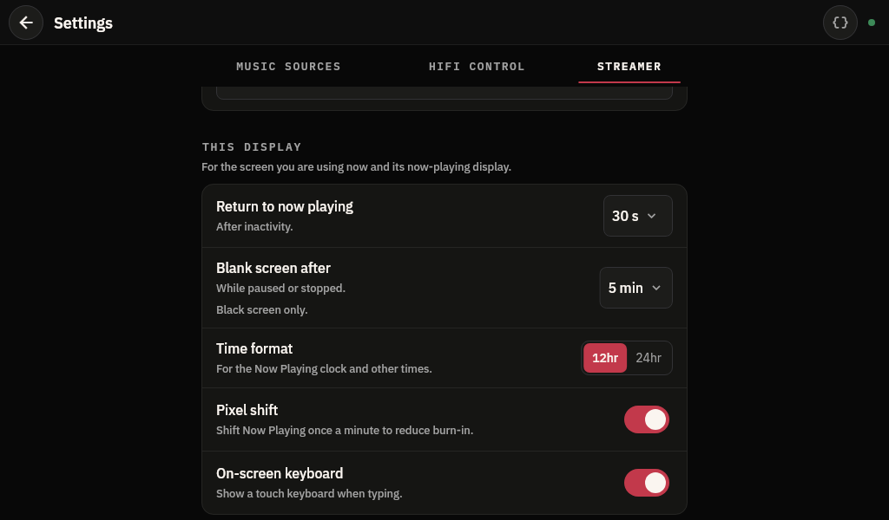

# Kalinka settings design guide

Settings use one fixed page title, a restrained dark header and directly accessible controls. This specification covers Settings, plugin settings and About, the expert settings list, change review, Download server logs and Output settings. All dimensions are Flutter logical pixels (dp); text sizes are before the system text scaler.

## Direction and rationale

The previous logs screen had the clearer information hierarchy: a title followed by the task. Plugin and advanced pages repeated that title in a large Playfair banner. Settings also used a transparent bar, while logs and output settings used a raised bar with a stronger divider and shadow.

Keep the logs screen's single-title structure, using a common implementation throughout settings. A subtle filled header identifies fixed navigation; one quiet rule separates it from scrolling content. Descriptions, state and actions remain visible without a second heading consuming vertical space.

This direction applies UI/UX Pro Max's minimal, functional layout guidance and its priorities for contrast, native controls, consistent spacing, keyboard focus, touch targets, safe areas and text scaling. Local searches covered dark music-player settings, accessible configuration, navigation consistency and Flutter text scaling. Marketing layouts, suggested replacement fonts and palettes do not fit this established utility interface; retain Kalinka's bundled fonts and semantic palette.

This is the settings specification. The branded player/search bars and editorial music-browsing headings serve different purposes. `PageBanner` remains available for those browsing pages. Existing confirmation dialogs and bottom sheets retain their modal typography; they do not repeat an underlying page title within the same surface.

## Page structure and navigation

1. `SettingsTopBar`, including the top safe area: Back, current page name, Revert and Apply while changes are staged, optionally one icon action, connection dot. The page's outer `SafeArea` uses `top: false`; the header applies the top inset inside its opaque background so the Android status-bar area matches the header. Controls remain below the system icons. Keep the page's side and bottom safe insets.
2. Optional secondary toolbar for page-specific controls, then the connection notice.
3. Optional pinned tabs on an overview. Other pages start with an introduction or their first controls.
4. Independently scrolling content, ending with 32dp breathing room. The host reserves space for the mini-player; content must not render underneath it.
5. While changes are staged, **Revert** and **Apply** lead the top bar's controls, after the title and before the page's own action and the connection dot. A renderer and Settings share them through `PendingChangesScope`: Settings puts one above every page it opens, so each page's bar carries them; beside the rail, where Settings' overview has no bar, they end the tab row ahead of the Expert switch. Nothing is laid at the page's foot.

   Both are round 40dp faces in 48dp targets, like Back. Revert is neutral (`surfaceElevated`, `borderDefault`, `textPrimary` undo glyph). Apply is amber like the staged rows: `statusPendingSurface` laid over `surfaceBase`, a 45% `statusPending` edge and a `statusPendingLight` glyph; while applying, a spinner takes the glyph's place and the label stays, so the bar does not reflow. Apply's glyph is always a check: beside undo, a restart arrow reads as reload, so what applying costs is said in the tooltip and the leave dialog instead. Each is named (14dp sans, 600) only while the title still fits on its line beside them; otherwise the title keeps the room and they show glyphs only. Tooltips and accessible names give the count and cost: *Apply 2 changes, restarts Kalinka*. When an issue blocks applying, Apply becomes **Review** (error glyph) and opens Check your changes; while applying both are inert. Whether they are named is judged on the wider of Apply and Review, so a change of state never flips it. Each first leaves the field being typed in, so its text is staged and the keyboard closes. In a field, the keyboard's Done keeps the value and closes the keyboard, and a number is staged as soon as it is one inside its bounds.

   Leaving Settings or a renderer's page with changes staged — Back, system Back, another rail destination, Settings opened over a renderer's page, or another output's gear in the picker — asks **Apply your changes?** in a `KalinkaDialog` with an amber `warning_amber` tile (`statusPending` tint, `statusPendingLight` glyph). It says what applying costs, lists up to six changes (an amber dot, then *where · setting*, e.g. *Qobuz · Email*; a collection's entries make one row) and then *and N more*, and offers **Discard** (neutral) and **Apply** (primary). Dismissing it stays on the page with the changes kept. Apply that the server holds back opens Check your changes instead of leaving; a renderer that refuses a value keeps its page open to say so.

Use sentence case: **Download server logs**, **Check your changes**. A renderer's page is titled with the renderer's name alone. Plugin titles include their subject: **Qobuz settings**, **About Qobuz**. Do not add breadcrumbs, a second large title, a logo in place of the title, or a decorative heading icon.

Keep setting descriptions short, with requirements and special values beside the control. Optional `help_details` appears behind an info button beside the setting label. Use `SettingsHelpButton` in regular, expert and setup views, including read-only fields. It opens the shared dialog with the setting name, detailed text and a Close button. Keyboard dismissal returns focus to the info button; pointer dismissal leaves it idle. Hover and press brighten the icon without a filled background or ripple. Keyboard focus uses a 2dp primary outline. Missing or blank details show no button.

Wrap text, numeric and password entries in `AppKeyboardTextEntry` and sliders in `AppKeyboardSlider`, including in dialogs and setup forms. Enter starts text editing. Enter or Space starts slider adjustment. Until then, arrow keys move focus past either control. Escape returns to navigation and preserves normal staging and validation. Enter also finishes slider adjustment. Show a neutral focus outline and a short keyboard hint during keyboard navigation. Pointer editing and intentional autofocus stay direct. [Keyboard navigation](browsing-design-guide.md#keyboard-navigation)

Omit section descriptions that repeat the heading or visible controls. When a section needs a caption, place it 4dp below the heading and leave 10dp before the card, matching collection captions.

Back closes the current panel through `SlideInPanel.closeOf(context)`. System Back does the same. Returning preserves the parent tab, scroll position and staged edits. Only the uppermost panel owns Back. The header remains outside the content scroll.
Renderer settings opens on a dashboard for the selected output. Its identity card shows reported connection and device details, with Rename when the name is writable. Rename opens a centered Kalinka dialog with an edit icon, a persistent field label and a rounded input prefilled with the current name. Saving writes the name on its own and leaves other edits pending. Show the playback chain for the current, connected output. While stopped, show the idle source and configured output. During playback, show the reported signal stages. Place the connected stages in a vertical rail to the left when both the rail and the settings column fit. In compact panes the path runs above the settings, turning at alternating edges. At enlarged text sizes use a single vertical path if two stages cannot fit side by side. Stage details wrap in full and assistive technology follows the signal from source to output. Underline stage names that lead to an editable setting on this renderer. Activation reveals the matching field or Room EQ card. An expert-only setting opens with its path already filtered. Source, decoded stream and dither are informational. Use the standard uppercase settings section labels. Group the reported controls under Audio output, Sound processing, DSD and Connected device. Center the dashboard in its pane at three quarters of the available content width, up to 750dp at normal text size. Keep the full width on phones and reserve enough space for enlarged text. In editable renderer rows, divide the content width equally between the title and description on the left and the field on the right. Stack them at full width in narrow panes. Display-only rows use the full width. Present read-only format limits as output capabilities. Keep renderer-specific sections accessible through their own editors. The speaker test targets the displayed renderer and requires pending changes to be applied or discarded first. ReplayGain belongs beside Volume control in **Output**. **Connected device** holds the external amplifier or receiver mapping. An output with parametric EQ or a REW FIR filter exposes **Room EQ**, which includes the FIR profile selector when supported. Wide panes place the preamp, FIR filter and EQ preset cards in one column to the right of the response graph. On compact screens they follow the band editor in the same order. The preset card stacks the picker, a crimson **Save preset** button and a neutral **Import REW** button with room between each control. The **Bypass DSP** switch at the right of the Room EQ header bypasses FIR, PEQ and preamp together while retaining each setting. **Enable PEQ** stays at the top right of the graph and scrolls with it. Place switches to the right of their labels. The PEQ curve is crimson when active and gray when bypassed or disabled. Draw its numbered handles in white with crimson outlines. The **Automatic** and **Manual** preamp chips use the text-only genre filter pill style. A bright outline marks the single selected mode. The Automatic explanation uses the 13dp settings caption. Automatic reserves headroom for EQ boosts. Manual reveals the stored gain in dB. Show the PEQ or bypass status above the choices. Align Room EQ card headings with the centre of a 48dp control, with 16dp side insets and 12dp below the content. Subdivide the horizontal dB grid between its five labeled lines according to plot height and retain the subtle response fill. During updates, a thin progress line overlays the bottom edge of the Room EQ header so the controls stay in place. The **FIR Convolution** selector carries its description behind its info button. On outputs that support import, **Import impulse WAV** accepts one file per sample rate and selects the named preset. The preset picker shows its available rates. On renderers with rate matching, explain how a supplied WAV overrides the converted filter for its rate. Show the reported FIR response as a dashed trace at the labeled preview rate. Distinguish the channels when their responses differ. The **Parametric bands** card sits below the graph. Tall, wide panes show each band’s shape icon, frequency, gain and Q. Phones and short panes use single-line chips with the band number, frequency and gain. Highlight the selected band number in crimson. Pair the response-shape icon with its name in the Add band menu and type selector. Low-pass and high-pass filters show their slope. Both orders have a cutoff frequency, with adjustable Q for 12 dB/octave. Their graph handles move horizontally. On a band card, hovering the icon shows its name. Follow graph selections in the strip and outline the selection in white. Place a plain **+** icon button at the end of the strip. Use a neutral highlight on hover and a highlight with a white outline on keyboard focus. Use the same **+** at the end of the chip row on compact layouts. The selected band’s settings share a card below the strip. Stack the three parameter sliders vertically on mobile. Frequency and Q use logarithmic scales and gain uses a linear scale. Dragging previews a change and releasing applies it. Tap the displayed value for exact entry. Double-tapping empty graph space adds a peak band. Graph details explain the preview rate, which defaults to 48 kHz before the renderer supplies a response. Presets apply to the EQ bands. Changing the preset, EQ switch or preamp writes directly to the renderer. Room EQ slides in from the right within the renderer settings pane. Back slides it out to the settings list. Releasing a graph handle or completing a band edit updates the current EQ on the renderer. **Save preset** stores a named copy for reuse.

**Import REW** opens a centered Kalinka form for Generic EQ text exports. The file row identifies the channels it serves and shows the chosen filename. **Separate channel files** reveals individual left and right rows. The first file supplies an editable preset name. File and name errors appear beside their fields. The crimson **Import** action becomes available when the name and required files are ready. The form names the output that will select the preset.

Renderer settings opens with focus on the toolbar scope. Its controls stay
unhighlighted until navigation begins. The first arrow highlights Back, and
Tab enters the renderer controls. Covered Streamer controls leave keyboard
traversal until the renderer panel closes.

Use the shared `KalinkaBackButton`: a 40dp outlined circle in a 48dp target, matching filter controls, with neutral hover/press and a primary keyboard focus ring. This also applies to browsing, search and setup; the album view retains its separate treatment. See [Back buttons](../PALETTE.md#back-buttons) for exact states.

The shell's labelled navigation rail remains available beside settings on wider windows. Settings occupy the browsing pane, leaving the player available, and use the shared adaptive split calculation. On phones, Settings remains in the existing server menu; settings retain their Back button with no additional navigation menu. Beside the rail, which names Settings and is how it is left, Settings has no top bar: its tabs start at the top of the pane, taking the top safe inset themselves. Choosing another destination runs the existing pending-change guard and cannot dismiss an active operation. Resizing preserves the current settings page and staged changes. The mini-player grows with system text size, and settings reserve that height.

Keep all three Settings tabs visible, with widths proportional to their label lengths. Uppercase mono labels ellipsize when needed, with full names in tooltips and accessibility labels. Music sources and HiFi control show a 7.8dp crimson dot (`accent`, `#C2394B`, matching the Update button) at the top right of their text while an installed plugin in that tab has an available update. Streamer shows the same dot when its software update status reports an available, supported system update, including component-only updates. System updates are independent of plugin update-check support. Include the plugin update count or “system update available” in the tab's tooltip and accessible name. Anchor the dot to the text, including when truncated, using the existing padding so updates do not move the tabs or their labels. Clear it when updates finish or their status reloads without an available update; unsupported checks show none.

About is a labelled icon button in a plugin's title bar; Revert and Apply come before it while changes are staged. Install/Uninstall belongs beside its status in the scrolling introduction. A renderer's page is titled with the renderer's name, in the top bar's title face, and ends its top bar with the Expert settings switch: a round 40dp `{}` icon button with a matching compact tap target, grey (`surfaceElevated`, `borderDefault`, `textSecondary` icon) while off and outlined in berry (`accentSubtle`, `accentBorder`, `accentTint` icon) while on, since expert is a mode the page stays in. Beyond Revert and Apply while changes are staged, do not add further controls to the title row.

## Colours and surfaces

Read these values from `KalinkaColors`, never duplicate hex literals in a screen.

| Role | Token | Value |
| --- | --- | --- |
| Page canvas | `background` | `#080808` |
| Fixed settings header | `surfaceBase` | `#0E0E0E` |
| Cards | `surfaceRaised` | `#151513` |
| Dialogs, popovers and bottom sheets (Connect reference) | `surfaceDialog` | `#151513` |
| Inputs | `surfaceInput` | `#171715` |
| Unselected pills / raised controls | `surfaceElevated` | `#1C1C1A` |
| Header-button hover / press | `surfaceOverlay` | `#222220` |
| Titles, values, Back, focus outline | `textPrimary` | `#FAF5F0` |
| Descriptions, captions, section labels | `textSecondary` | `#A3A3A3` |
| Low-emphasis supporting text | `textMuted` | `#858585` |
| Header/card/row divider | `borderSubtle` | `#11FFFFFF` (white, 6.67% opacity) |
| Input borders | `borderDefault` | `#323235` |
| Selected tab and switch track when on (thumb `textPrimary`) | `accent` | `#C2394B` |
| Switch when off: thumb `textSecondary` on a `surfaceElevated` track edged in `borderDefault`; disabled, either state at reduced opacity, the thumb still visible | `textSecondary` | `#A3A3A3` |
| Online dot | `statusOnline` | `#3D8A58` |
| Connecting/reconnecting dot | `statusPending` | `#C8943A` |
| Offline dot | `statusOffline` | `#858585` |
| Plugin error text and icon | `statusError` | `#E86A6A` |
| Online badge text on tinted fill | `statusOnlineLight` | `#5FB07E` |
| Pending badge text on tinted fill | `statusPendingLight` | `#E8B86A` |

The header always has the same opaque fill, a 1dp bottom rule and no shadow or elevation. There is no transparent variant. Card borders and internal row dividers are also 1dp. These rules group content; they are not the only cue identifying a control. Settings and search tabs share the PLAYING / QUEUE button: 8dp horizontal and 12dp vertical padding, 8dp gaps, 6dp rounded corners, `surfaceInput` on hover and `surfaceOverlay` on keyboard focus. The underline sits inside the horizontal padding, 4dp above the bottom, with 1dp rounded ends. Align the first tab’s visible label to the page content gutter; its 8dp highlight padding extends outside that gutter and remains visible inside the scroll viewport. They have no rule under them: only the selected tab's 2dp berry indicator, then the content. Tab labels stay on one line at their full width in a horizontally scrollable strip, with 48dp minimum targets. Keep the active tab visible when selecting a tab or resizing the pane, and keep the strip pinned above the vertically scrolling content.

Dialogs and bottom sheets share Connect's neutral `surfaceDialog` background, including plugin editors, option pickers and confirmations. Keep Material surface tint transparent. Their X uses the shared `OverlayCloseButton`: the filter dialog's 34dp outlined circle, 18dp primary icon and 48dp target. Hover/press use a neutral fill and brighter ring; keyboard focus uses a primary ring. See [dialog and sheet chrome](../PALETTE.md#dialogs-and-bottom-sheets) for the exact states. Preserve the kiosk output panel's dedicated controls.

Sheets remain bottom sheets on phones. On desktop/tablet windows they become centered dialogs without a beak, with a 60% black scrim behind them. All dialogs opened from settings, including Drives & Shares’ **+** form, center in the **whole window**, as do confirmations and notices. Cap settings dialogs at the shared settings content width, `kKalinkaContentMaxWidth` (560dp), using `dialogMaxWidth` for adaptive editors and pickers. Compact forms and confirmations retain their narrower 460dp cap. Only output selector, Filters and Connect use beaked dialogs, with no background dimming. Use the whole window's usable dimensions (width at least 720dp and greater than the 640dp sheet cap, height at least 480dp), even for a narrow settings or player pane. Short landscape phones keep sheets and their dimmed background. Use the shared helpers so positioning avoids screen edges and keyboards, outside tap/Escape dismiss, and staged edits survive crossing the breakpoint. References to sheets below describe their content and phone presentation; their wide presentation defaults to a centered, dimmed dialog.

Measured sRGB contrast: primary/secondary text on the header is **17.82:1 / 7.65:1**; on cards it is **16.88:1 / 7.25:1**. Muted text on a card is **4.95:1**. Keep normal text at least 4.5:1 and meaningful icons at least 3:1. Do not use the base green as small text on cards (4.33:1); use the brighter status text token on its intended tinted surface. Recheck the composed colour when introducing any tint or opacity.

## Typography

Use the bundled IBM Plex families. System text scaling is respected, not clamped. Where a line height is not specified below, preserve the font's natural metrics and let the row grow.

| Element | Family | Size / weight | Line height / tracking |
| --- | --- | --- | --- |
| Single page title | IBM Plex Sans | 18 / 600 | 24dp; −0.1dp tracking |
| Page introduction | IBM Plex Sans | 14 / 400 | 21dp |
| Setting label or action | IBM Plex Sans | 16 / 500 | Natural; −0.1dp tracking |
| Help, caption and metadata | IBM Plex Sans | 13 / 500 | Natural; no added tracking |
| Inline plugin status | IBM Plex Sans | 13 / 500 | 18.2dp; sentence case; no added tracking |
| Section label | IBM Plex Mono | 13 / 600 | Natural; 1.8dp tracking; uppercase |
| Settings tab | IBM Plex Mono | 13 / 600 | `sectionLabel`, as PLAYING / QUEUE; 1.5dp tracking; uppercase |
| Server name in identity card | Playfair Display | 24 / 500 | Natural; no added tracking |
| Server address | IBM Plex Sans | 16 / 400 | Natural; inherited −0.1dp tracking |

`KalinkaTextStyles.settingsPageTitle` and `settingsDescription` own the first two styles. Other rows use the established `trayRowLabel`, `trayRowSublabel` and `sectionHeaderMuted` tokens. Use Playfair Display for the server name in its identity card to carry the application's visual style; navigation-bar titles remain IBM Plex Sans.

## Geometry and spacing

**Customise Home** follows the same fixed header, typography and page gutters. With no pins, it shows one-tap pinning instructions and source tiles. With pins, its introduction explains drag reorder and tapping a name to change it on Home, then notes that search, collections and sources stay in place. Use `settingsDescription`, 20dp vertical padding and a full-width `borderSubtle` separator. Rows contain the editable Home name, source/filter metadata, preview preference, drag handle and round 48dp preview/unpin buttons. Preview content stays on Home. The anchored picker offers Automatic / Small preview / Large preview / Shortcut only with geometric illustrations, a crimson outline and checkmark on the current choice, immediate saving and the existing three-second idle dismissal. It uses four columns when they fit, two on narrower panes, and one at large text sizes. Tapping a name opens a centered optional-name editor; an empty name restores the original. Unpin uses a centered Cancel / Unpin confirmation. All dialogs use the whole window and dimmed backdrop. See [Customise Home](../PALETTE.md#customise-home) and [adaptive Home previews](home-catalogs.md).

| Element | Specification |
| --- | --- |
| Header | 52dp minimum height; grows for wrapped/scaled titles |
| Header padding | Left 6, right 16, top/bottom 2dp |
| Back/action target | At least 48 × 48dp; icon 22dp |
| Back-to-title gap | 8dp |
| Title-to-optional-action gap | 8dp |
| Revert / Apply | 40dp faces in 48dp targets; icon 18dp; named: 12dp before the icon, 6dp icon/label gap, 16dp after, 8dp between |
| Space before connection dot | 12dp |
| Connection dot | 8 × 8dp, centred in a 48dp-high status region |
| Back shape / focus | 40dp circle; 2dp primary-colour focus outline |
| Other header button corners / focus | Radius 8dp; 2dp primary-colour focus outline |
| Page gutter | 20dp below the 900dp app-window breakpoint; 25dp at/above it |
| Secondary toolbar | Page gutter horizontally; 8dp vertically; 12dp between items, 8dp between wrapped runs |
| Scrolling introduction | Page gutter horizontally; 20dp above and below |
| Status/actions-to-description | 12dp |
| Status/detail wrap | 8dp horizontal, 4dp vertical |
| Section heading inset | Page gutter; 20dp above, 10dp below |
| Source/device catalog grouping | First group 24dp below tabs; later groups 36dp above; 8dp below label |
| Card | Radius 14dp; 1dp subtle border; 12dp bottom margin |
| Standard setting row | 16dp horizontal, 12dp vertical padding; flexible height |
| Vertical field control | 10dp below its label/help block |
| Logs first card | 20dp below the header/notices |
| End of scrolling content | 32dp |

The header's 6dp outer inset places the Back glyph within the visual page gutter while retaining its full touch target. Its title aligns after Back; body sections align to the page gutter. Do not indent all body content to the title's x-position.

The 25dp tablet gutter is an existing Kalinka layout token. Keep it consistent across settings instead of independently rounding individual pages. Content layout still responds to the **actual panel width**, not just the window breakpoint. On a wider panel the gutter grows, so settings and Customise Home content stays at most 560dp wide (`kKalinkaContentMaxWidth`), centred, while backgrounds, scroll areas and the top bar's Back keep to the panel's edges. Read the gutter below `ConfigurationAppearance`, which measures the panel. Setup screens — server discovery, Bluetooth and hotspot setup, and every setup step — share one centred 600dp column with 20dp sides: the same 560dp of content.

## Plugin identity, status and description

In overview rows, group the name and its status on the first line. Wrap the whole status onto the next line when needed. The catalog description follows after 4dp; publisher/maturity tags follow that description after 6dp. Live summaries and pending-change details form the last metadata line, with 8dp above. Align the icon tile to the top of the text group.

On Settings and About pages, keep the single fixed page title. Start the scrolling introduction with the plugin's status and live summary, followed by its description after 12dp. About's compatibility information follows the description. Install/Uninstall stays alongside the status where space permits and moves below it on narrow layouts. Enabled and other controls follow the introduction, separate from the read-only live state.

Use sentence-case **Ready**, **Warning**, **Error**, **Disabled**, and operation labels as unboxed text, with a 16dp icon and a 6dp icon/text gap. Ready uses a check icon and `statusOnlineLight`; Warning uses a warning icon and `statusPendingLight`; Error uses an error icon and `statusError`; inactive states use `textSecondary`. The text and icon communicate state without relying on colour. Publisher tags remain visually distinct from operating status.

Keep a backend message with its status. An Error/Warning with an explanation gets 12dp padding, a 2dp left rule in the status colour and a 7% status-colour background; place the message 8dp below the status line using 14dp/21dp primary text. Preserve backend wording and inline formatting. Show this message once, including when the plugin has no editable settings; do not repeat it in the fields card. A return to Ready removes the obsolete error. Plugin pages expose a contextual status label to assistive technology; errors and operations can announce updates without moving focus.

## Plugin settings

A plugin's settings follow its introduction and controls as labelled cards, with nothing folded away. Each collection, each section and each run of fields opened by a heading takes a card under a section label, the collection's help as a caption under its label; fields before any of these share an unlabelled first card. The server sets the order: a collection follows the field it is placed after, a section comes before the field it is placed before. A section with a switch of its own starts its card with that switch, and its other rows dim while it is off. A section inside a card opens in place under a small label, or with none where it only groups other sections. A status field reads as a line under the help of the setting before it, never as a row of its own.

A collection lists one row per entry: a 36dp icon tile, where the entry points, and its kind beneath. A row opens the entry in a sheet. The status the server reports for the collection follows the rows, and the card ends with one compact neutral button per kind of entry (**Folder on the server**, **Network share**), or a single **Add** where there is one kind; a long label is cut at large text rather than overflowing. A button opens the sheet for that kind, titled with it and describing it, so the sheet never asks for the kind again. The form's first group has no heading, as the sheet's title already introduces it.

Temporarily hide the **Choose a folder on the server** button in all settings, regardless of server capabilities, while server folder browsing is broken. Keep manual path entry and server-provided suggestions available. Retain the folder picker implementation for later repair.

**Storage** is a section of the Streamer tab (`base_config.storage`): **Mount USB drives automatically** and **Show drives as a source**, then the **Mounts** collection with one button per kind, **NFS share** and **Disk on this machine**, as any collection lays them out.

## Streamer content

On the Streamer tab, the Expert settings switch ends the Settings top bar, as on a renderer's page; where the top bar is hidden beside the navigation rail, it ends the tab row instead. It is the same round `{}` button and the same setting: one switch for the whole app, kept on the device so it survives switching tabs, leaving and restarting. On, the tab's body is the expert list in place of the groups below; there is no separate Advanced settings page.

The expert list is drawn as the simple page draws settings: a search field alone at the top (no introduction above it), pinned under the tabs on the page's own background, then every field as a standard setting row in one card (`surfaceRaised`, 14dp radius, 1dp `borderSubtle` border and dividers; rows 16dp × 12dp, `trayRowLabel` name, the dotted path in `textMuted` mono under it, `trayRowSublabel` help, the control 10dp below; staged rows tinted and ruled in amber as elsewhere). A renderer's expert list is the same.

Off, keep this order directly on the tab:

| Group | Contents |
| --- | --- |
| SERVER | Identity card: name and pencil, selectable address, server version, raw backend supervisor status |
| THIS DISPLAY | Preferences for the screen Settings is open on: the now-playing display's timeouts where they apply, time format, pixel shift and on-screen keyboard |
| SOFTWARE UPDATES | Bundle/component update state and automatic updates in one card |
| MANAGEMENT | Restart Kalinka, Network, dashboard (except on flutter-pi), restart streamer, power off streamer, when supported |
| SUPPORT | Download server logs |

The name is a prominent value, not a duplicate page heading. Its 48dp pencil opens a bottom sheet; Done stages the name, Cancel/Back discards the sheet edit. Apply follows the existing settings flow. Fields marked `applies_live` save without restarting Core; mixed changes still use the restart flow. Renaming the streamer can interrupt AirPlay receivers that inherit its name, as the server-provided help explains. Settings reads refresh the connected server's saved label without changing its address or reconnecting.

The address has 16dp side padding, a 4dp label/value gap and 20dp bottom padding. The metadata area has 16dp padding, 8dp between details and 16dp between label/value columns. At less than `280 × textScaler.scale(1)` available width, each detail stacks its label above its value with a 4dp gap. Do not truncate an address or status.

**Network** appears only for a box with a supervisor. It opens a **Network** page that hosts the same network panel as setup: the current wired or Wi-Fi connection, and the Wi-Fi networks the box can join. The **Wi-Fi region** row opens the same searchable country picker in Settings and setup. It uses the time zone picker’s centered dialog on wide screens and bottom sheet on phones. Search accepts country names and two-letter codes.

**THIS DISPLAY** holds its settings directly on the tab, in one card under the note “For the screen you are using now and its now-playing display.” in `trayRowSublabel`, 4dp below the group label. The name ties them to the screen Settings is open on rather than to the streamer. Changes save immediately in local preferences. Every client can set **Time format**, **Pixel shift** and **On-screen keyboard**.

On the streamer's enabled display or an explicit kiosk launch, show two dropdowns first. **Return to now playing** offers 15 s, 30 s, 1 min and 2 min, and defaults to 30 s. **Blank screen after** offers Off, 5 min, 10 min, 15 min and 30 min, and defaults to 5 min. Place each dropdown beside its label and help. Use the anchored neutral Bluetooth menu style. Store seconds, with 0 for Off. Show backlight capability beside the blanking setting. Blanking applies while paused or stopped. Touch, keyboard input or resumed playback wakes the display and consumes the waking input.

Display the supervisor status exactly as the backend returns it; do not parse a version or infer health from “Installed”. Package updates show the components the backend identifies as changed. Sound-card controls belong in Output settings. Device automation belongs in the expert list.

**Time format** follows the timeouts, or comes first without them. It offers
**12hr** and **24hr** as two connected segments (`SettingsEnumPills`), each as
wide as the longer label, beside the label and help. Below
`300 × textScaler.scale(1)` of row width they move under the label, still at
that width. The platform's preference is selected until one is chosen;
flutter-pi reports none, so a streamer's display starts on 12-hour whatever its
time zone. Save the choice to this device's SharedPreferences
(`Kalinka.display.use24HourClock`) and apply it to every time the app shows,
the Now Playing clock included, as `MediaQuery.alwaysUse24HourFormat`.

**Pixel shift** is on by default. It moves the Now Playing
foreground a few pixels once a minute. Switching it off returns the foreground
to its original position immediately and saves the preference for this device.

Default **On-screen keyboard** on for Kalinka's
Flutter Pi launcher (`localDisplayKioskProvider`), and off elsewhere. Use that
default only when no preference is saved; an explicit on or off always wins.
Save immediately
to this device's SharedPreferences (`Kalinka.client.onScreenKeyboard`), independent
of server connections, display capability and staged server settings. Switching it
off restores platform input. Keyboard labels, previews and pickers use Kalinka's
existing IBM Plex Sans; do not bundle additional keyboard fonts.
The keyboard uses neutral Kalinka surfaces and labels;
the setting's enabled switch carries the crimson fill. Float the keyboard over
the whole app Navigator, centered at the bottom, with no full-width strip behind
it. Keep the catalogue and rail painted and interactive beside it. Settings
pages, sheets and dialogs reserve the keyboard inset once so the active field
and its contents stay visible while editing.
Keep the whole panel within 37% of the window height (260dp at most),
including the bottom safe area. Derive its width from the available key height
and the standard four-row, ten-column letter layout, allowing character keys up
to twice as wide as they are tall. Include the 4dp column gaps and toolbar in
that width; cap it at the available window width and 900dp. Center the panel and
its surface together so
there are no empty side bands. At 1024×600 the English layout is 900×222, with
48dp-tall letter keys and 378dp above it. Use clearly visible 6dp gaps between
rows. Keep Hide in a 52dp side column in landscape and in a 48dp toolbar above
the keys in portrait. The grid has one action key matching the field, such as
Done, Search or Next. Numeric and multiline layouts use the toolbar for that
action so the number keys and line break remain available. Preserve keypad
state on rotation. Use 24dp IBM Plex Sans character labels. A warm-white outline
marks the remote target. Activating a key briefly brightens its face.
Use the neutral sheet surface with rounded top corners. Slide up in 180ms and
down in 140ms without a backdrop or dismiss barrier. First let the phone or
tablet mini-player slide out; restore it only once the keyboard has closed.
This applies to catalogue text filters as well as main search and settings.
Skip both transitions with reduced motion, and do not wait for a bar that is
already hidden. Keep the catalogue and its results interactive above the keys.
Keep the field's focus while tapping keys or opening accent/language menus;
preserve the active field, draft and selection when resizing moves a catalogue
search between its toolbar and narrow-screen row. Resizing must not reopen a
keyboard the user has dismissed. Preserve formatters,
password masking, selection and field submit actions. Provide Hide and an explicit
Done/Search/Next action even on numeric layouts. Touches count as local kiosk
activity, and the blanking host covers both the app and keyboard.

Long-press accents use compact horizontal rows of at least 48dp character buttons,
wrapping on narrow screens without a scrollbar. Keep uppercase alternatives and
the field's selection intact. Outside tap or Escape dismisses the choices without
inserting a character; Escape leaves the keyboard open while a picker is showing.

Place an outlined globe key immediately beside Space. A tap opens a language
grid with all 16 layouts: four columns on smaller panes and five when the picker
is at least 800dp wide. Keep at least 48dp targets and 8dp gaps. Mark the current
layout with a check and neutral outline. The picker can extend above the keyboard
without enlarging it or dimming the app; retain field focus and selection. It
reflows when the window resizes. Use full language names normally, and short
language codes on narrow panes where names would break across lines. Large text
can reduce the column count to keep the codes readable; full names remain in
tooltips and accessibility labels. Never use a scrolling list. A
selection applies immediately; X, outside tap or Escape cancels it. Holding
Space remains an alternative way to open the same grid.

## Responsive layout and interaction

- Page titles wrap naturally with no ellipsis, fixed line limit, auto-shrink or capped text scaler. When the 18dp title scales above 27dp (1.5×), place it on a full-width second row **inside the same fixed header**, inset to the page gutter, with 10dp bottom padding plus the header’s 2dp outer padding. Back, the optional action and status stay on the first row. This avoids a narrow column of oversized text between icons.
- `SettingsPageIntro` stacks status and action below 320dp of **content width**, or when 14dp text scales above 18.2dp (1.3×). Otherwise status expands beside the action. Descriptions always use the full intro width.
- A device name in the top bar stays on one line beside the title: each keeps its own width while both fit, else the shorter keeps its width or each takes half, and the name ends in an ellipsis with its full text in a tooltip. When the title takes its own row at large text, the name keeps the first row's room before the switch.
- Use native `IconButton`/`TextButton` for header/toolbar actions, with a visible keyboard focus outline. Keep visual bounds stable on focus, hover and press. Button tooltips name the action; decorative icons are excluded from semantics.
- Mark the page title as a semantic header. Give the connection dot a readable status tooltip and an accessible label containing the current server name and status. Colour alone is insufficient. The dot is not a button.
- Keep destructive confirmation and pending-change behaviour intact. Layout changes must not initiate a restart, update, download or power-off.
- Respect safe areas and the host's mini-player allocation. Lists scroll within the remaining height. Avoid placing fixed elements over the list.
- Panel motion uses `kSlideInPanelDuration` (320ms, cubic 0.4/0/0.2/1); skip the slide when the system disables animations, and where Settings is switched to as a destination (from the rail or Customise Home). Header interactions add no movement or layout shifts.

## Implementation and verification

Reuse `SettingsTopBar`, `SettingsToolbar` and `SettingsPageIntro`; do not create another private header in a screen. `ConfigurationAppearance` supplies shared gutters and section spacing. The common `SlideInPanel` owns Back and panel transitions.

For changes to this system, check 375dp phone, narrow 320dp, landscape and tablet-panel layouts; normal, 2× and large system text; reduced motion; long plugin/device names; connected and disconnected states; keyboard Back and About; and pending edits on return. Verify the logs options/prepare/save flow and renderer Expert mode still work. Review actual rendered screens with bundled fonts in addition to widget assertions. These checks validate the changed settings surfaces; they are not a claim of an app-wide accessibility audit.

Reference: [UI/UX Pro Max skill](../../../.codex/skills/ui-ux-pro-max/SKILL.md), especially its `references/pro-rules.md` and accessibility, interaction and typography priorities. The repository tokens and shared widgets are the implementation source of truth; update this document with them when the design changes.

## Receiver connections

Mobile **Connect** belongs in the existing music-source strip. Wide layouts
show one **Connect** button with the same icon in the sidebar, opening a compact
anchored popup with the same content as Home's Connect. Collections follows the
last music source, then a subtle divider and Connect, without a CONNECT section
heading. Keep the Connect button even with only one enabled receiver.
Show installed, enabled receivers only, independently of
catalog availability. There is no dedicated Bluetooth header action, large
Home connection row, or duplicated renderer picker. Enable/disable stays in
plugin Settings.

The sidebar popup has a small pointer toward the centre of its Connect button,
drawn as part of the same neutral surface and border. Keep the popup within the
screen and move the pointer along its edge when height requires shifting it.
Reveal it from the button outward over 180ms with an ease-out curve and subtle
fade, matching More's shelf; clip the reveal so the content never compresses or
reflows. Closing takes 120ms and can be interrupted by reopening. Reduced motion
shows and hides it immediately. Preserve outside-tap and Escape dismissal and
return keyboard focus to Connect after keyboard dismissal. Pointer dismissal
clears its focus. Connect's grey highlight follows the popup's open state only;
hover and restored keyboard focus do not fill it, and keyboard focus uses a
separate outline.

The compact sheet shows actual receiver names and sessions. Bluetooth renders
**Bluetooth · Pair new**, followed by a separate Paired devices group; no expansion or
separate audio-permission switch. Pair new uses the shared compact primary
`KalinkaButton`, with its berry fill and pill shape. Pair opens the backend's two-minute Just Works
window. The sender may show its normal pairing prompt, but Kalinka needs no
comparison code or second approval. The backend countdown appears beside Bluetooth while pairing is open. A compact
Stop pairing action sits beside it. The countdown uses a monotonic deadline per
window and ticks at each second boundary between backend updates. Delayed
snapshots do not extend the window or restart the tick phase. Closing the sheet
leaves pairing running.
Successful pairing grants audio access automatically. Device rows show an icon, name and Paired/Connected status, with a green dot
for connected audio. Each row has a vertical ellipsis menu with **Disconnect** for an
audio session and **Forget** for the bond. Use a generic device icon until the
server supplies a device type. Forget requires confirmation: it removes shared setup
pairing too, keeps Wi-Fi configuration and requires re-pairing. Leave 16dp before
the paired-device label and 8dp before its rows. Align a custom receiver name
under the receiver title, keeping it separate from the devices. Device names
wrap at large text sizes.
Use `KalinkaDialog` and shared buttons: centered in the whole window with a dimmed background at every width. Cancel is neutral and gets
initial keyboard focus. Forget uses the berry action style. Keep the message
short: "Removes the Bluetooth pairing. Pair again to reconnect."

Separate the panel introduction from the first receiver by 20dp, and put 20dp
on either side of the divider between receivers. Receiver failures, failed
actions and inventory errors use the shared `FailureNote`, with an error icon,
readable wrapped text and live-region semantics, 12dp below the related controls.
Show the backend error once instead of repeating a generic unavailable line.
Keep any reported paired devices visible and respect the backend's action
availability even when the module reports an error. An unavailable backend can
return an empty peer list without deleting its bonds: show **No paired devices**
in `textMuted` only when the receiver is ready and inventory is available.
Hide that empty-state message during errors, startup and shutdown. AirPlay's
password status is shown only while its receiver state is available and ready.

The generic app-wide approval host remains available for controllers which
actually publish a pending request. It preserves supplied comparison codes,
explicit decisions and backend cancellation/expiry, including when the panel
is closed. The current Just Works controller publishes no such requests.
Commands are never automatically replayed after a timeout.

AirPlay is one row with its icon, title and password status. Without a password,
show **No password required**. When reveal is allowed, show **Password required -
click to reveal** with a downward chevron. Tapping the row reveals the password
in large monospace text directly below it. Tapping again hides it. Do not add
instructions or a separate Show password button. Keep custom receiver names
visible. Unavailable receivers must not offer a reveal action.
Password application uses the existing secret setting; its help warns that
applying it restarts AirPlay and ends its session. Revealed text is discarded
and pending reveals are invalidated as soon as closing starts, including when
the exit animation is interrupted by reopening. Also discard it on
backgrounding, lost availability or removal of the password. These
surfaces reuse the existing theme, text styles and responsive spacing.

Receiver operations use a spinner in the existing control bounds. AirPlay replaces
its password chevron while fetching. Bluetooth replaces the affected device's
ellipsis during Disconnect or Forget. Pairing uses the Pair new or Stop pairing
control's space. Loading indicators must not add a row or change the panel size.
